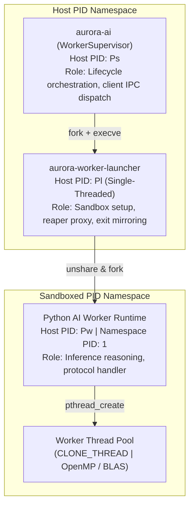
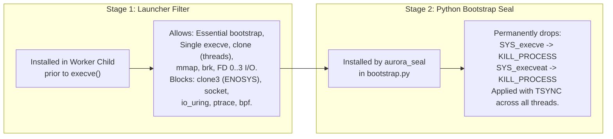
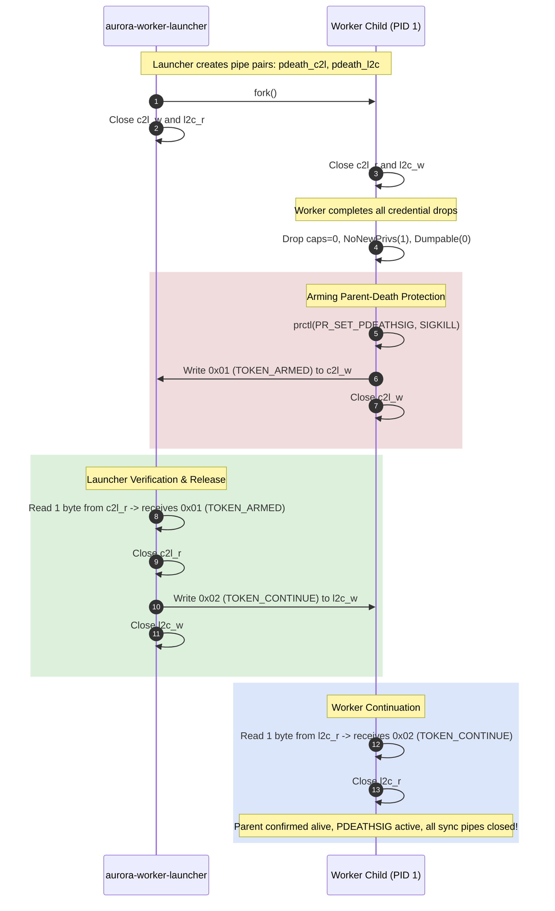
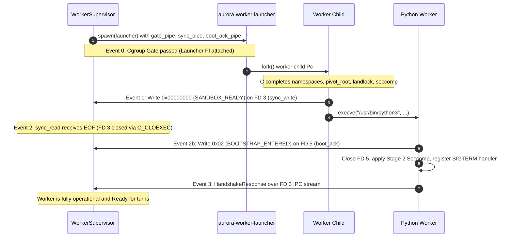
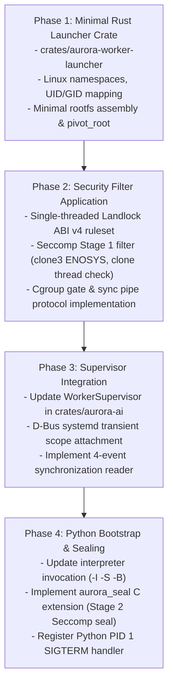

# Aurora OS Milestone 10b: Sandbox Architecture and Design Specification

* **Document Status:** Formally Approved (Option C)
* **Milestone:** Milestone 10b (Sandbox Architecture and Design)
* **Date:** 2026-11-23
* **Primary Author:** Aurora OS Architecture & Security Engineering
* **Approved Architecture:** Option C (Native Rust Trusted Launcher + Systemd-Assisted Cgroup v2 Resource Management)
* **Supervision Model:** Three-Tier Hierarchy (`aurora-ai` $\to$ `aurora-worker-launcher` $\to$ Python AI Worker PID 1)
* **Traceability Baseline:**
  - [ADR-001: Core Daemon Language, Initial Worker Runtime, and Process Boundary](../decisions/0001-core-daemon-and-worker-runtime-architecture.md)
  - [ADR-002: Capability and Permission Architecture](../decisions/0002-capability-and-permission-architecture.md)
  - [ADR-003: Anonymous Socketpair IPC Transport](../decisions/0003-socketpair-ipc-transport.md)
  - [ADR-004: Operating-System-Level Sandboxing and Confinement for AI Worker Processes](../decisions/0004-worker-os-sandboxing-and-process-isolation.md)
  - [AI Worker Threat Model](../security/worker-threat-model.md)
  - [Worker Security & Sandbox Requirements](../security/worker-sandbox-requirements.md)
  - [Milestone 10a Plan](../plans/m10/m10a-plan.md)
  - [Milestone 10b Plan](../plans/m10/m10b-plan.md)

---

## 1. Executive Summary & Security Invariant

Aurora OS incorporates artificial intelligence as an untrusted, unprivileged guest service. While ADR-001, ADR-002, and ADR-003 established logical separation, capability dispatching, and anonymous socketpair IPC, the underlying Python worker process historically ran as an unconfined operating system process sharing the host user's UID and GID.

Milestone 10 establishes a defense-in-depth, operating-system-enforced security boundary around the Python AI worker. 

The authoritative **Milestone 10 Security Invariant** is:

> **"If the Python AI worker is completely compromised, it must not gain unrestricted access to the host system. It must operate within an explicitly defined, operating-system-enforced security boundary."**

Milestone 10b defines the comprehensive architectural design to satisfy this invariant under full Arbitrary Code Execution (ACE) without relying on Python-level cooperative guardrails.

---

## 2. Architectural Decision and Rationale

### 2.1 The Approved Architecture: Option C (Hybrid Architecture)
Aurora OS formally adopts **Option C: Hybrid Native Rust Trusted Launcher + Systemd-Assisted Cgroup v2 Resource Management**.

```
+---------------------------------------------------------------------------------------+
|                                      HOST SYSTEM                                      |
|                                                                                       |
|  +-------------------------+                 +-------------------------------------+  |
|  |        aurora-ai        |                 |               systemd               |  |
|  |   (WorkerSupervisor)    |-- D-Bus IPC --->|      (Transient Scope Manager)      |  |
|  +-------------------------+                 +-------------------------------------+  |
|               |                                                 |                     |
|         fork() & execve()                                       | Attach Pl           |
|               v                                                 v                     |
|  +-------------------------+                 +-------------------------------------+  |
|  |  aurora-worker-launcher |<================|       aurora-worker-<Pl>.scope      |  |
|  | (Host PID Pl, Single-Th)|                 | (memory.max, pids.max, cpu.max)     |  |
|  +-------------------------+                 +-------------------------------------+  |
|               |                                                 | Inherited           |
|     unshare() & fork()                                          | Containment         |
|               v                                                 v                     |
|  +---------------------------------------------------------------------------------+  |
|  |                         CONFINED SANDBOX DOMAIN                                 |  |
|  |                                                                                 |  |
|  |   Namespaces: CLONE_NEWUSER, CLONE_NEWNET, CLONE_NEWNS, CLONE_NEWPID            |  |
|  |   Rootfs:     Minimal tmpfs root via pivot_root (Host detached)                 |  |
|  |   Procfs:     Private /proc mounted with subset=pid                             |  |
|  |   Landlock:   ABI v4 ruleset (ReadOnly libs, Execution restricted to python3)   |  |
|  |   Seccomp:    Stage 1 (clone3 ENOSYS, clone thread mask, io_uring denied)       |  |
|  |               Stage 2 (execve/execveat permanently sealed via aurora_seal)      |  |
|  |                                                                                 |  |
|  |   +-------------------------------------------------------------------------+   |  |
|  |   |                        Python AI Worker (PID 1)                         |   |  |
|  |   |   Invocation: python3 -I -S -B /app/worker/bootstrap.py                 |   |  |
|  |   |   IPC: Pre-connected Unix socketpair stream (FD 3)                      |   |  |
|  |   +-------------------------------------------------------------------------+   |  |
|  +---------------------------------------------------------------------------------+  |
+---------------------------------------------------------------------------------------+
```

### 2.2 Rejection of Pure In-Daemon Launcher (Option A)
Spawning sandboxes directly from the multi-threaded Rust daemon (`aurora-ai`) using `fork()` in `pre_exec` is unsafe:
- **POSIX Async-Signal-Safety**: In a multi-threaded process running Tokio and D-Bus threads, calling non-async-signal-safe functions (memory allocators, complex string formatting, mount syscalls) between `fork()` and `execve()` causes deadlocks and undefined behavior.
- **Landlock Multithreading Invariant**: Landlock rulesets cannot be applied to a multi-threaded process on kernels lacking ABI 8 (`LANDLOCK_RESTRICT_SELF_TSYNC`). The daemon is inherently multi-threaded.

### 2.3 Rejection of Pure External Container Manager (Option B)
Relying entirely on external container engines (Podman, Docker, bubblewrap, or `systemd-run --scope` wrappers) creates unacceptable deployment friction:
- Incurs heavy container startup overhead and introduces brittle external CLI dependencies.
- `systemd-run --scope` wraps the binary in an intermediate process, disrupting the direct parent-child relationship needed by `std::process::Child` for PID reaping and signal escalation.

### 2.4 Why Option C Succeeds
- **Dedicated Single-Threaded Context**: The launcher is a standalone, statically linked or minimal native Rust executable (`aurora-worker-launcher`). It executes strictly on a single operating system thread, guaranteeing 100% async-signal-safe sandbox setup and native Landlock ABI v4 compatibility.
- **Native D-Bus Cgroup Integration**: `WorkerSupervisor` attaches the launcher PID to a systemd transient scope via D-Bus prior to worker creation, enforcing kernel resource boundaries without wrapper processes.
- **Rootless & Unprivileged**: Uses Linux unprivileged user namespaces (`CLONE_NEWUSER`), requiring zero root privileges or `sudo`.

---

## 3. Process Hierarchy and Responsibilities

The sandbox operates under a strict **three-tier process hierarchy**:



### 3.1 Responsibilities Matrix

| Entity | Binary / Implementation | Namespace Context | Primary Responsibilities |
| :--- | :--- | :--- | :--- |
| **WorkerSupervisor** | `crates/aurora-ai` (Rust) | Host namespace | Manages IPC socketpair, establishes cgroup scopes, executes shutdown escalation ladder, manages lazy recovery and backoff. |
| **Trusted Launcher** | `crates/aurora-worker-launcher` (Rust) | Host PID ns; Unprivileged User ns | Establishes namespaces, configures rootfs, applies Landlock & Seccomp Stage 1, forks worker, acts as reaper proxy, mirrors exit codes. |
| **Worker Process** | `/usr/bin/python3` (Python/C) | Confined PID ns (PID 1) | Runs trusted bootstrap, applies Seccomp Stage 2 (`aurora_seal`), registers SIGTERM handler, processes IPC requests over FD 3. |

### 3.2 Proxy Reaping and Exit Code Mirroring
The launcher process remains alive for the entire duration of the worker session as a lightweight, unprivileged reaper proxy:
1. The launcher blocks in `waitpid(Pw, &status, 0)` (or a signal-aware wait loop).
2. When the Python worker terminates:
   - If exited normally (`WIFEXITED(status)`): Launcher calls `exit(WEXITSTATUS(status))`.
   - If terminated by signal (`WIFSIGNALED(status)`): Launcher resets the handler for signal $S = \text{WTERMSIG}(status)$ to `SIG_DFL` and calls `raise(S)`.
3. Consequently, `WorkerSupervisor`'s `child.try_wait()` observes the **exact exit code or terminating signal** as if it were directly parenting the Python process.
4. If Python crashes (e.g. `SIGSEGV` or `SIGKILL`), the launcher exits immediately with the corresponding status, triggering the supervisor's lazy restart logic.

---

## 4. Launcher Architecture and Lifecycle

`aurora-worker-launcher` is implemented as a minimal standalone Rust crate (`crates/aurora-worker-launcher`):
- Compiled as a minimal binary without Tokio, async executors, or background thread pools.
- Executes sequentially on a single thread from entry point to exit.
- Drops all heap memory before entering its wait loop.

```mermaid
sequenceDiagram
    autonumber
    participant S as WorkerSupervisor
    participant L as aurora-worker-launcher
    participant C as Worker Child (PID 1)
    participant P as Python Worker

    S->>L: fork() & execve("aurora-worker-launcher")
    Note over L: Phase 1: Parent-Death Init & Stderr Redirect
    L->>L: prctl(PR_SET_PDEATHSIG, SIGKILL) targeting Supervisor
    L->>L: Assert getppid() == supervisor_pid
    L->>L: Redirect FD 1 to /dev/null, FD 2 to stderr log pipe
    
    Note over L: Phase 2: Cgroup Attachment Gate
    L->>L: Read 1 byte from FD 4 (gate_read)
    Note over S: Supervisor attaches Pl to cgroup scope via D-Bus
    S->>L: Write 0x01 (GATE_CONTINUE) to gate_write
    L->>L: Close FD 4 (gate_read)

    Note over L: Phase 3: Intermediate Setup & PID NS Creation
    L->>L: unshare(CLONE_NEWUSER | CLONE_NEWNET | CLONE_NEWNS)
    L->>L: Write "deny" to /proc/self/setgroups
    L->>L: Write uid_map and gid_map (map host UID/GID to container UID/GID 1000)
    L->>L: mount(NULL, "/", NULL, MS_REC | MS_PRIVATE, NULL)
    L->>L: Assemble sandbox_root tmpfs and read-only bind mounts
    L->>L: unshare(CLONE_NEWPID)
    L->>L: Create pdeath pipe pairs (c2l and l2c)
    L->>C: fork() -> Worker Child born as PID 1

    Note over L: Phase 4: Launcher Cleanup & Handshake
    L->>L: close(0) (Drop worker-side IPC socket reference immediately!)
    L->>L: close(3) (sync_write), close(5) (boot_ack_write)
    L->>L: Read TOKEN_ARMED (0x01) from child on c2l_r; close c2l_r
    L->>C: Write TOKEN_CONTINUE (0x02) to child on l2c_w; close l2c_w
    L->>L: Launcher enters waitpid(Pw) proxy loop

    Note over C: Phase 5: Confinement, Pivot & Execve
    C->>C: unshare(CLONE_NEWNS) -> independent mount namespace
    C->>C: Mount private /proc (subset=pid)
    C->>C: pivot_root(sandbox_root, put_old) & umount2(put_old, MNT_DETACH)
    C->>C: close_range(10, UINT_MAX, 0) -> Purge setup dirfds (>= 10)
    C->>C: Strip capabilities, set NoNewPrivs(1), Dumpable(0)
    C->>C: prctl(PR_SET_PDEATHSIG, SIGKILL) targeting Launcher
    C->>L: Write TOKEN_ARMED (0x01) on c2l_w; close c2l_w
    C->>C: Read TOKEN_CONTINUE (0x02) on l2c_r; close l2c_r
    C->>C: Apply Landlock ABI v4 & Seccomp Stage 1
    C->>S: Write 0x00000000 (SANDBOX_READY) to FD 3 (sync_write)
    C->>P: execve("/usr/bin/python3", ["python3", "-I", "-S", "-B", "/app/worker/bootstrap.py"])
    Note over S: FD 3 closed via O_CLOEXEC -> sync_read gets EOF
```

---

## 5. Namespaces Architecture

The sandbox combines four Linux namespaces to isolate the worker from host resources:

```
+-------------------------------------------------------------------------------------+
|                                 SANDBOX NAMESPACES                                  |
|                                                                                     |
|   +-----------------------+   +-----------------------+   +---------------------+   |
|   |    User Namespace     |   |   Network Namespace   |   |    PID Namespace    |   |
|   |    (CLONE_NEWUSER)    |   |    (CLONE_NEWNET)     |   |   (CLONE_NEWPID)    |   |
|   |                       |   |                       |   |                     |   |
|   |  - Rootless operation |   |  - Zero network ifaces|   |  - Worker is PID 1  |   |
|   |  - UID 1000 inside    |   |  - Loopback is DOWN   |   |  - Host PIDs hidden |   |
|   |  - All caps dropped   |   |  - No TCP/UDP/sockets |   |  - Subtree cleanup  |   |
|   +-----------------------+   +-----------------------+   +---------------------+   |
|                                                                                     |
|   +-----------------------------------------------------------------------------+   |
|   |                              Mount Namespace                                |   |
|   |                               (CLONE_NEWNS)                                 |   |
|   |                                                                             |   |
|   |  - Fully independent mount table decoupled from Launcher                    |   |
|   |  - MS_REC | MS_PRIVATE propagation                                          |   |
|   |  - Atomic pivot_root to private tmpfs                                       |   |
|   +-----------------------------------------------------------------------------+   |
+-------------------------------------------------------------------------------------+
```

1. **User Namespace (`CLONE_NEWUSER`)**:
   Provides rootless privilege separation. Allows unprivileged sandbox configuration while stripping all host ambient authority.
2. **Network Namespace (`CLONE_NEWNET`)**:
   Provides absolute network disconnection. The network namespace is created with zero physical or virtual network interfaces, and the `lo` loopback interface is deliberately left **DOWN**. Any attempt to bind, listen, or connect returns immediate network errors.
3. **PID Namespace (`CLONE_NEWPID`)**:
   Hides all host and sibling processes. The worker child is forked as PID 1. Signals cannot be sent to host processes. When PID 1 terminates, the kernel destroys all remaining tasks in the namespace.
4. **Mount Namespace (`CLONE_NEWNS`)**:
   Worker executes `unshare(CLONE_NEWNS)` immediately after `fork()`. This gives the worker an independent mount namespace, strictly isolating its VFS table from the launcher.

---

## 6. UID/GID Mapping and Capability Removal

### 6.1 `setgroups` Denial and Single Mapping
Linux kernel security hardening mandates that unprivileged user namespaces must disable group manipulation before mapping GIDs. The launcher executes:
1. `unshare(CLONE_NEWUSER)`.
2. Open `/proc/self/setgroups` and write `"deny"`.
3. Open `/proc/self/uid_map` and write `"1000 <host_uid> 1\n"`.
4. Open `/proc/self/gid_map` and write `"1000 <host_gid> 1\n"`.

This maps the invoking host user to UID/GID 1000 inside the sandbox.

### 6.2 Capability Stripping and Non-Acquisition
Although the process acquires user-namespace-scoped capabilities upon `CLONE_NEWUSER`, all capabilities are permanently purged before executing Python:
1. **Bounding Set Purge**: Loop from 0 to `CAP_LAST_CAP` calling `prctl(PR_CAPBSET_DROP, cap, 0, 0, 0)`.
2. **Ambient Set Clear**: Call `prctl(PR_CAP_AMBIENT, PR_CAP_AMBIENT_CLEAR_ALL, 0, 0, 0)`.
3. **Effective & Permitted Clear**: Call `capset()` with zeroed capability descriptors.
4. **Permanent Privilege Lock (`NoNewPrivs`)**: Call `prctl(PR_SET_NO_NEW_PRIVS, 1, 0, 0, 0)`. This guarantees that neither the worker nor any child can acquire elevated privileges via SUID binaries or file capabilities.
5. **Anti-Tracing (`PR_SET_DUMPABLE`)**: Call `prctl(PR_SET_DUMPABLE, 0, 0, 0, 0)` to prevent same-UID external processes from attaching via `ptrace` or dumping process memory.

---

## 7. Minimal Root Filesystem and `pivot_root`

### 7.1 Why `chroot` is Inadequate
`chroot(2)` alone does not alter the underlying mount namespace. An unprivileged process inside a user namespace can escape a chroot via open file descriptors outside the tree or by manipulating mounts. `pivot_root(2)` moves the root mount of the entire mount namespace, detaching the host VFS completely.

### 7.2 Mount Sequence and Construction
Inside the worker child's private mount namespace:
1. **Private Mount Propagation**:
   `mount(NULL, "/", NULL, MS_REC | MS_PRIVATE, NULL)`.
2. **Root Tmpfs Creation**:
   Mount a fresh, private tmpfs at `/tmp/aurora_root_XXXXXX`:
   `mount("tmpfs", sandbox_root, "tmpfs", MS_NODEV | MS_NOSUID, "size=64M,mode=0755")`.
3. **Directory Skeleton**:
   Create mount points: `/usr`, `/lib`, `/lib64`, `/bin`, `/dev`, `/proc`, `/tmp`, `/app`, `/put_old`.
4. **Read-Only System Bind Mounts**:
   Bind-mount `/usr`, `/lib`, `/lib64`, and the application root `/app` read-only:
   - Modern Linux ($\ge 5.12$): Use `mount_setattr(dirfd, "", AT_EMPTY_PATH | AT_RECURSIVE, &attr, sizeof(attr))` with `MOUNT_ATTR_RDONLY | MOUNT_ATTR_NOSUID | MOUNT_ATTR_NODEV`.
   - Fallback: Traditional two-step remount (`MS_BIND | MS_REC` followed by `MS_BIND | MS_REMOUNT | MS_RDONLY | MS_NODEV | MS_NOSUID | MS_REC`).
5. **Minimal `/dev` Tmpfs**:
   Mount tmpfs at `/dev` (`size=64k,mode=0755,nosuid,noexec`).
   Bind-mount character devices from host:
   - `/dev/null` (Read/Write)
   - `/dev/zero` (Read-only)
   - `/dev/urandom` (Read-only)
   - Symlink `random -> urandom`.
   No pseudo-terminals (`/dev/pts`) or physical devices exist in the sandbox.
6. **Scratch Storage `/tmp`**:
   Mount dedicated tmpfs at `/tmp` (`size=128M,mode=0700,nosuid,nodev,noexec`).
7. **Atomic `pivot_root` Execution**:
   ```c
   syscall(SYS_pivot_root, sandbox_root, sandbox_root_put_old);
   chdir("/");
   umount2("/put_old", MNT_DETACH);
   rmdir("/put_old");
   ```
The host root filesystem is completely unmounted and detached from the VFS namespace.

---

## 8. Private Procfs and Telemetry Protection

### 8.1 The Telemetry Leak Hazard
Standard `/proc` mounts expose global host telemetry (`/proc/stat`, `/proc/meminfo`, `/proc/cpuinfo`, `/proc/sys/*`) even in private PID namespaces. Reading these files directly allows a compromised worker to bypass the daemon's capability mediation (`sys.cpu.read`, `sys.memory.read`).

### 8.2 Procfs `subset=pid` Configuration
The worker mounts procfs inside its private mount namespace as:
```c
mount("proc", "/proc", "proc", MS_NODEV | MS_NOSUID | MS_NOEXEC, "subset=pid");
```
When mounted with `subset=pid` (Linux $\ge 5.8$):
- Procfs exposes **only** PID directories and `/proc/self`, `/proc/thread-self`.
- Top-level telemetry files (`/proc/stat`, `/proc/meminfo`, `/proc/cpuinfo`) **do not exist and return `ENOENT`**.

### 8.3 Strict Mode Safe Refusal
If `mount("proc", ... "subset=pid")` returns `EINVAL` (e.g. kernel lacking `subset=pid` support):
- **In Strict Production Mode**: The launcher **refuses to start the worker** and aborts immediately with `ERR_PROCFS_SUBSET_PID_UNSUPPORTED`. Strict mode **never falls back to ordinary procfs**.
- **In Permissive Development Mode**: The launcher falls back to masking: it mounts standard procfs and immediately bind-mounts `/dev/null` over `/proc/stat`, `/proc/meminfo`, and `/proc/cpuinfo`, followed by read-only remounting.

---

## 9. Landlock ABI Compatibility and Handled-Rights Policy

### 9.1 Probed Runtime Baseline
Runtime probing on `Linux 6.8.0-1070-azure` confirmed **Landlock ABI v4**. Upstream Linux 6.10 introduced ABI v5 (`LANDLOCK_ACCESS_FS_IOCTL_DEV`), and Linux 7.0 introduced ABI 8 (`LANDLOCK_RESTRICT_SELF_TSYNC`).
- **Baseline Invariant**: The single-threaded trusted launcher is mandatory to enforce Landlock on ABI v4 without multithreaded synchronization.
- **Dynamic ABI Probing**: The launcher invokes `landlock_create_ruleset(NULL, 0, LANDLOCK_CREATE_RULESET_VERSION)`. If ABI $\ge 8$ is reported, `LANDLOCK_RESTRICT_SELF_TSYNC` is enabled as an optional feature.

### 9.2 Complete Handled Rights Mask (ABI v4)
Any access right not included in `handled_access_fs` is unrestricted by Landlock. The sandbox explicitly defines the complete ABI v4 handled bitmask:

```c
#define AURORA_HANDLED_ACCESS_FS_V4 ( \
    LANDLOCK_ACCESS_FS_EXECUTE | \
    LANDLOCK_ACCESS_FS_WRITE_FILE | \
    LANDLOCK_ACCESS_FS_READ_FILE | \
    LANDLOCK_ACCESS_FS_READ_DIR | \
    LANDLOCK_ACCESS_FS_REMOVE_DIR | \
    LANDLOCK_ACCESS_FS_REMOVE_FILE | \
    LANDLOCK_ACCESS_FS_MAKE_CHAR | \
    LANDLOCK_ACCESS_FS_MAKE_DIR | \
    LANDLOCK_ACCESS_FS_MAKE_REG | \
    LANDLOCK_ACCESS_FS_MAKE_SOCK | \
    LANDLOCK_ACCESS_FS_MAKE_FIFO | \
    LANDLOCK_ACCESS_FS_MAKE_BLOCK | \
    LANDLOCK_ACCESS_FS_MAKE_SYM | \
    LANDLOCK_ACCESS_FS_REFER | \
    LANDLOCK_ACCESS_FS_TRUNCATE \
)

#define AURORA_HANDLED_ACCESS_NET_V4 ( \
    LANDLOCK_ACCESS_NET_BIND_TCP | \
    LANDLOCK_ACCESS_NET_CONNECT_TCP \
)
```

### 9.3 Scoped Execution & Path Access Matrix

| Path | Allowed Rights | Explicitly Prohibited Rights | Purpose |
| :--- | :--- | :--- | :--- |
| **`/usr/bin/python3`** | `EXECUTE`, `READ_FILE` | All write, make, remove, refer, truncate | Canonical Python interpreter. |
| **`/lib64/ld-linux*`** | `EXECUTE`, `READ_FILE` | All write, make, remove, refer, truncate | Dynamic linker. |
| **`/lib`, `/lib64`, `/usr/lib`** | `READ_FILE`, `READ_DIR` | `EXECUTE`, all write, make, remove, refer | Shared libraries & Python stdlib. Execution of standalone binaries from `/lib` is denied. |
| **`/app` (Worker Code)** | `READ_FILE`, `READ_DIR` | `EXECUTE`, all write, make, remove, refer | Application source tree. Strictly immutable. |
| **`/tmp` (Scratch)** | `READ_FILE`, `WRITE_FILE`, `READ_DIR`, `MAKE_REG`, `MAKE_DIR`, `REMOVE_FILE`, `REMOVE_DIR`, `TRUNCATE` | `EXECUTE`, `MAKE_CHAR`, `MAKE_BLOCK`, `MAKE_FIFO`, `MAKE_SOCK`, `MAKE_SYM`, `REFER` | Scratch storage. Execution of files created in `/tmp` is prohibited. |
| **`/dev/null`, `/dev/zero`** | `READ_FILE`, `WRITE_FILE` | `EXECUTE`, all make, remove, refer | Standard I/O null/zero sinks. |
| **`/dev/urandom`** | `READ_FILE` | `EXECUTE`, all write, make, remove, refer | Cryptographic entropy source. |
| **`/proc/self/exe`** | `READ_FILE` | `EXECUTE`, all write, make, remove, refer | Binary path resolution. |
| **`/proc/self/fd`** | `READ_DIR` | `EXECUTE`, all write, make, remove, refer | Descriptor inspection. |
| **Network (TCP)** | *None (Empty ruleset)* | `BIND_TCP`, `CONNECT_TCP` | Worker is completely barred from TCP operations. |

*Crucial Distinction*: `LANDLOCK_ACCESS_FS_EXECUTE` governs only file-based binary execution via `execve`/`execveat`. It does not restrict in-memory machine code execution (e.g. JIT buffers). In-memory execution is controlled via Seccomp Stage 2, `W^X` memory protections, and capability dropping.

---

## 10. Seccomp Architecture (Two-Stage Progressive Filtering)

To satisfy least-privilege execution, Seccomp filtering is divided into two distinct, progressive stages:



- **Stage 1 (Pre-Exec Launcher Filter)**: Installed in the worker child after forking and dropping capabilities, immediately before `execve()`. Allows memory management, threading, and a single `execve` to start Python.
- **Stage 2 (Post-Bootstrap Interpreter Seal)**: Applied by `aurora_seal` in `bootstrap.py` before any application or third-party code is imported. Permanently disables `SYS_execve` and `SYS_execveat`.

---

## 11. `clone3` Fallback and `clone(2)` Flag Filtering

### 11.1 Glibc `clone3` Fallback Mechanism
In classic BPF, argument inspection is limited to register arguments (`args[0]` to `args[5]`). For `clone3(struct clone_args *cl_args, size_t size)`, `args[0]` is a user-space pointer. Classic BPF cannot dereference pointers in user memory.

**Enforced Contract**:
The Seccomp filter intercepts `SYS_clone3` and immediately returns:
`SECCOMP_RET_ERRNO(ENOSYS)`

- **Validated Glibc Behavior**: In glibc (`sysdeps/unix/sysv/linux/clone-internal.c`), `__clone3` explicitly tests for `errno == ENOSYS`. Upon receiving `ENOSYS`, glibc falls back immediately to traditional `clone(2)`. Any other return value (e.g. `EPERM`) causes thread creation to abort. Returning `ENOSYS` is the documented, tested contract for triggering glibc's internal fallback.

### 11.2 `clone(2)` 64-Bit Inspection and Flag Masks
On x86_64, system call arguments are 64 bits wide. The filter verifies that the **upper 32 bits of `args[0]` are zero**, and inspects the lower 32 bits against strict flag bitmasks:

```c
#define CLONE_MANDATORY_THREAD_FLAGS ( \
    CLONE_THREAD | CLONE_VM | CLONE_FS | CLONE_FILES | CLONE_SIGHAND | CLONE_SYSVSEM \
)

#define CLONE_ALLOWED_THREAD_MASK ( \
    CLONE_THREAD | CLONE_VM | CLONE_FS | CLONE_FILES | CLONE_SIGHAND | CLONE_SYSVSEM | \
    CLONE_SETTLS | CLONE_PARENT_SETTID | CLONE_CHILD_CLEARTID | CLONE_DETACHED \
)
```

**Filter Rules**:
1. Upper 32 bits of `flags` must be 0 $\to$ otherwise `SECCOMP_RET_KILL_PROCESS`.
2. Lower 32 bits must include all mandatory flags: `(flags & MANDATORY) == MANDATORY` $\to$ otherwise `SECCOMP_RET_KILL_PROCESS`.
3. Lower 32 bits must contain no disallowed flags: `(flags & ~ALLOWED_MASK) == 0` $\to$ otherwise `SECCOMP_RET_KILL_PROCESS` (prohibits `CLONE_NEW*`, `CLONE_PARENT`, `CLONE_VFORK`).
4. Exit signal (`flags & 0xFF`) must be 0 (no signal on thread termination) $\to$ otherwise `SECCOMP_RET_KILL_PROCESS`.

---

## 12. x32 Syscall ABI Rejection & Syscall Denials

### 12.1 x32 ABI Rejection
The x32 ABI (ILP32 on x86_64) shares the audit architecture identifier `AUDIT_ARCH_X86_64`. To prevent attackers from bypassing filters by issuing x32 system calls, every filter checks:
1. `arch == AUDIT_ARCH_X86_64` $\to$ otherwise `SECCOMP_RET_KILL_PROCESS`.
2. `(nr & 0x40000000) == 0` (`__X32_SYSCALL_BIT`) $\to$ otherwise `SECCOMP_RET_KILL_PROCESS`.

### 12.2 Explicit Prohibitions: `io_uring`, `socketpair`, and `SCM_RIGHTS`
1. **`io_uring` Denial**:
   `SYS_io_uring_setup`, `SYS_io_uring_enter`, and `SYS_io_uring_register` are explicitly intercepted and return `SECCOMP_RET_ERRNO(EPERM)`.
2. **`SYS_socketpair` Denial**:
   `SYS_socketpair` is **explicitly denied** in both Seccomp stages (returning `SECCOMP_RET_ERRNO(EPERM)` or `SECCOMP_RET_KILL_PROCESS`). The worker must use only the pre-existing socketpair established by `WorkerSupervisor`.
3. **`SCM_RIGHTS` Prevention**:
   Ancillary file descriptor passing requires sending a `struct cmsghdr` via `sendmsg`, `sendmmsg`, `recvmsg`, or `recvmmsg`. These system calls are **completely denied**. Scalar stream syscalls (`read`, `write`, `sendto`, `recvfrom`) have no kernel mechanism to transmit control messages, making descriptor transfer structurally impossible.

---

## 13. Python Trusted Bootstrap and Native Sealing Module

### 13.1 Interpreter Invocation Invariant
The launcher invokes Python with isolated flags:
```bash
/usr/bin/python3 -I -S -B /app/worker/bootstrap.py
```
- `-I` (Isolated Mode): Ignores all `PYTHON*` environment variables and ignores current working directory in `sys.path`.
- `-S`: Disables `import site`. Global `.pth` files, `sitecustomize.py`, and `usercustomize.py` are **never executed**.
- `-B`: Disables writing compiled `.pyc` files.
- `envp`: Explicitly sanitized environment containing only `["PYTHONUNBUFFERED=1", "LC_ALL=C.UTF-8", "LANG=C.UTF-8", NULL]`. All host variables (`LD_PRELOAD`, `LD_LIBRARY_PATH`, `PYTHONPATH`) are eliminated.

### 13.2 Modern Native Extension Loading
Because `-I -S` prevents ambient directory additions to `sys.path`, `bootstrap.py` uses modern Python 3.10+ `importlib` APIs to load `aurora_seal` directly from its canonical path:

```python
"""Aurora OS Worker Bootstrap - Phase 1: Security Sealing."""
import importlib.util
import os
import signal
import sys

# 1. Positively acknowledge bootstrap entry to Supervisor (Closes Event 2b)
BOOT_ACK_FD = 5
try:
    os.write(BOOT_ACK_FD, b"\x02")
    os.close(BOOT_ACK_FD)
except OSError:
    sys.exit(1)

# 2. Directly load trusted aurora_seal native extension by canonical path
SEAL_SO_PATH = "/app/worker/aurora_seal.so"
spec = importlib.util.spec_from_file_location("aurora_seal", SEAL_SO_PATH)
if spec is None or spec.loader is None:
    sys.exit(1)
aurora_seal = importlib.util.module_from_spec(spec)
spec.loader.exec_module(aurora_seal)

# 3. Apply permanent Seccomp Stage 2 Filter (drops execve/execveat with TSYNC)
ret = aurora_seal.apply_stage2_seal()
if ret != 0:
    sys.exit(1)

# --- SECURITY SEAL ACTIVE: No external binary can be executed from this point forward ---

# 4. Register PID 1 SIGTERM signal handler
signal.signal(signal.SIGTERM, lambda signum, frame: sys.exit(143))

# 5. Safely initialize application environment and hand over to worker.main
sys.path.insert(0, "/app")
import worker.main
sys.exit(worker.main.main())
```

*Security Invariant*: Third-party modules, tokenizer native code, and model runtimes are only imported **after** Seccomp Stage 2 is permanently active.

---

## 14. Complete Descriptor Ownership and Lifecycle Manifest

The table below tracks every file descriptor across all seven lifecycle stages:

| FD # | Underlying Resource | Owning Process | `O_CLOEXEC` | Purpose | Exact Closure Stage |
| :---: | :--- | :--- | :---: | :--- | :--- |
| **0** | `sp_worker` (IPC Socket) | Supervisor $\to$ Launcher $\to$ Child | No | Worker-side bidirectional IPC socket | **Launcher**: Closed immediately post-fork.<br>**Python**: Duplicated to FD 3, then FD 0 redirected to `/dev/null`. |
| **0** | `/dev/null` (Read-only) | Python Steady State | No | Safe stdin replacement sink | Retained for lifetime of worker. |
| **1** | `/dev/null` (Write-only) | Launcher $\to$ Child $\to$ Python | No | Standard output sink | Retained for lifetime of worker. |
| **2** | Stderr Log Pipe (`log_w`) | Launcher $\to$ Child $\to$ Python | No | Bounded asynchronous stderr pipe | Retained for lifetime of worker. |
| **3** | `sync_write` (Sync Pipe) | Launcher $\to$ Child | **Yes** | Signals `SANDBOX_READY` (0x00000000) | **Launcher**: Closed immediately post-fork.<br>**Child**: Closed by kernel automatically on `execve`. |
| **3** | `sp_worker` (Active IPC) | Python Steady State | **Yes** | Active worker IPC stream socket | Duplicated from FD 0 during Python initialization; closed upon worker exit. |
| **4** | `gate_read` (Cgroup Gate) | Launcher | **Yes** | Awaits cgroup attachment confirmation | **Launcher**: Closed immediately after reading token `0x01` (prior to namespace unsharing). |
| **5** | `boot_ack_write` | Child $\to$ Python Bootstrap | No | Positively acknowledges Python bootstrap entry | **Launcher**: Closed immediately post-fork.<br>**Python**: Closed by `bootstrap.py` immediately after writing byte `0x02`. |
| **6** | `c2l_r` (`pdeath_c2l` Read) | Launcher | **Yes** | Awaits `TOKEN_ARMED` (0x01) from child | **Launcher**: Closed immediately upon receiving `TOKEN_ARMED`. |
| **7** | `c2l_w` (`pdeath_c2l` Write)| Child | **Yes** | Sends `TOKEN_ARMED` (0x01) to launcher | **Launcher**: Closed immediately post-fork.<br>**Child**: Closed immediately after writing token. |
| **8** | `l2c_r` (`pdeath_l2c` Read) | Child | **Yes** | Awaits `TOKEN_CONTINUE` (0x02) from launcher| **Launcher**: Closed immediately post-fork.<br>**Child**: Closed immediately upon receiving token. |
| **9** | `l2c_w` (`pdeath_l2c` Write)| Launcher | **Yes** | Sends `TOKEN_CONTINUE` (0x02) to child | **Launcher**: Closed immediately after writing token.<br>**Child**: Closed immediately post-fork. |
| **$\ge$ 10** | Intermediate setup dirfds | Launcher / Child | **Yes** | Mount scaffolding / pivot_root setup | Explicitly closed before `pivot_root`; purged via `close_range(10, UINT_MAX, 0)`. |

### 14.1 Inherited Host-FD Elimination Protocol
Landlock does not retroactively revoke access to open descriptors. To eliminate host descriptor leakage:
1. All directory descriptors used during mount operations are closed.
2. In the worker child, immediately after `pivot_root`, `chdir("/")`, and `umount2("/put_old", MNT_DETACH)`, setup descriptors 10 and above are no longer needed. The child executes:
   `close_range(10, UINT_MAX, 0);`
   This purges all intermediate setup descriptors ($\ge 10$) while preserving the required low descriptors: FD 0 (IPC socket), FD 1 (`/dev/null`), FD 2 (stderr log pipe), FD 3 (`sync_write`), FD 5 (`boot_ack_write`), and FD 6–9 (parent-death synchronization pipes).
3. Subsequent descriptor closures occur deterministically:
   - **FD 4** (`gate_read`) is closed by the launcher immediately after cgroup gate completion (prior to namespace unsharing).
   - **FD 6–9** (`pdeath` pipes) are closed immediately after parent-death synchronization completes.
   - **FD 3** (`sync_write`) is closed automatically through `O_CLOEXEC` during successful Python `execve`.
   - **FD 5** (`boot_ack_write`) is closed by `bootstrap.py` immediately after the Python bootstrap acknowledgement (`os.close(5)`).
4. The child asserts via `/proc/self/fd/` that no unapproved descriptors remain open. Steady-state Python retains strictly FD 0, 1, 2, and 3. If any extraneous descriptor exists, the child terminates immediately via `_exit(EXIT_FAILURE)`.

---

## 15. Cgroup v2 and Systemd Integration

### 15.1 Production Desktop Integration: Systemd D-Bus
In standard Linux environments, `WorkerSupervisor` attaches the launcher process ($P_{launch}$) into a systemd transient scope via D-Bus:
1. `WorkerSupervisor` spawns `aurora-worker-launcher` ($P_{launch}$).
2. Connects to `org.freedesktop.systemd1` on the user session bus.
3. Invokes `StartTransientUnit`:
   - `Name`: `"aurora-worker-" + Pl + ".scope"`
   - `Mode`: `"fail"`
   - `Properties`:
     - `("PIDs", [Pl])`
     - `("MemoryMax", 536870912)` (512 MiB)
     - `("TasksMax", 32)`
     - `("CPUQuota", 100%)`
     - `("Delegate", false)`

### 15.2 Delegated Subtree Management
If Aurora OS runs within a delegated user slice (`Delegate=yes`), the supervisor writes directly to `cgroup.procs` under `/sys/fs/cgroup/aurora.slice/worker-<Pl>/cgroup.procs`, respecting systemd's single-writer rule.

### 15.3 The Startup Gate Handshake
The launcher **must not fork the Python worker** until cgroup attachment is confirmed:
1. Launcher pauses at startup gate: `read(gate_read_fd, &token, 1)`.
2. Supervisor attaches $P_{launch}$ to the scope via D-Bus and verifies that `/sys/fs/cgroup/.../cgroup.controllers` has active controllers.
3. Supervisor writes `0x01` (`GATE_CONTINUE`) to `gate_write`.
4. Launcher receives the token, closes `gate_read_fd`, and proceeds to fork the worker child. The worker child automatically inherits the cgroup constraints from its parent.

---

## 16. Strict and Permissive Security Modes

Aurora OS supports two operational sandbox modes:

| Security Mode | Trigger Condition | Cgroup v2 | Procfs `subset=pid` | Fallback Controls | Failure Action |
| :--- | :--- | :---: | :---: | :--- | :--- |
| **`strict`** (Production) | Production default; systemd present | **Mandatory** | **Mandatory** | None | Refuses startup (`SANDBOX_CGROUP_UNAVAILABLE` or `ERR_PROCFS_SUBSET_PID_UNSUPPORTED`). |
| **`permissive`** (Development) | Container / non-systemd environments | Optional | Masking Fallback | POSIX `RLIMIT_CORE=0`, `RLIMIT_NOFILE=64`, `RLIMIT_FSIZE=100M`, tmpfs 128M | Logs warning; continues execution under degraded isolation. |

*Explicit Limitation*: Permissive mode lacks per-worker aggregate memory containment, CPU scheduling shares, and task-count limits. It does not provide equivalent protection to strict mode.

---

## 17. Resource Defaults and Assumptions

- **`memory.max = 512M`**: Enforces a hard physical and kernel memory ceiling. Memory pressure triggers cgroup OOM termination of the sandboxed worker without impacting `aurora-ai`.
- **`pids.max = 32`**: In cgroup v2, `pids.max` limits **all kernel tasks (TIDs)**, including threads. This accommodates 1 launcher thread, 1 Python main thread, and up to 30 worker/math threads (e.g. OpenBLAS).
- **`cpu.max = 100000 100000`**: Caps CPU bandwidth to 100% of 1 CPU core.
- **`RLIMIT_CORE = 0`**: Prevents core dumps from leaking model weights or memory state.
- **`RLIMIT_FSIZE = 100M`**: Restricts individual file creation size.
- **Tmpfs Quota (`size=128M`)**: Bounds aggregate disk consumption across scratch storage.

---

## 18. Parent-Death Synchronization Protocol

To close the race window between `fork()` and `prctl(PR_SET_PDEATHSIG)`, a two-way synchronization handshake is executed over dedicated pipe pairs (`pdeath_c2l` and `pdeath_l2c`):



The worker **never relies on `getppid()`**, which returns `0` inside child PID namespaces.

---

## 19. Startup and Shutdown Sequences

### 19.1 Four-Event Startup Synchronization Progression



### 19.2 Preserved M9 Shutdown Escalation Ladder

| Escalation Stage | Trigger Condition | Mechanism | Timeout | Outcome |
| :--- | :--- | :--- | :--- | :--- |
| **Stage 1: Graceful EOF** | Normal shutdown or client exit | Supervisor closes `sp_daemon` | **200 ms** | Python read loop receives EOF, cleans up, exits with code 0. Launcher reaps child, exits with code 0. |
| **Stage 2: SIGTERM** | Worker unresponsiveness | Supervisor sends `SIGTERM` to launcher ($P_{launch}$) | **300 ms** | Launcher forwards `SIGTERM` to child. Python SIGTERM handler exits with code 143. Launcher reaps child, exits. |
| **Stage 3: SIGKILL** | Worker deadlock or unhandled signal | Supervisor sends `SIGKILL` to launcher ($P_{launch}$) | **Immediate** | Kernel kills launcher. Child receives `SIGKILL` via `PR_SET_PDEATHSIG` or ancestor kill. Entire PID namespace is destroyed. |
| **Stage 4: Mandatory Reap** | Any termination path | Supervisor calls `child.wait()` | Blocking | Reaps launcher handle, verifies clean exit or signal, resets state. |

---

## 20. IPC Compatibility with ADR-003

The sandbox strictly preserves the [ADR-003](../decisions/0003-socketpair-ipc-transport.md) transport:
1. **Anonymous Socketpair**: Established via `socketpair(AF_UNIX, SOCK_STREAM, 0)`.
2. **Immediate Launcher Closure**: The launcher closes its copy of FD 0 post-fork, ensuring the Python worker is the sole possessor of the worker-side endpoint.
3. **Descriptor Duplication & Redirection**: In `worker/main.py`, FD 0 is duplicated to FD 3 via `socket.fromfd(0, ...)` and FD 0 is redirected to `/dev/null`.
4. **Framing Limit**: Strict 512 KiB framing is preserved. Excess data triggers immediate connection closure.

---

## 21. Verification and Failure-Handling Architecture

1. **Procfs Independent Verification**:
   `WorkerSupervisor` verifies `/proc/<Pl>/status` and `/proc/<Pw>/status` to confirm `NoNewPrivs: 1` and `Seccomp: 2`.
2. **Exit Code Propagation**:
   The launcher mirrors the worker's exit code, preserving supervisor crash detection and lazy restart.
3. **Structured Diagnostics**:
   If sandbox setup fails pre-exec, the child writes an error code and diagnostic string to `sync_write` before exiting, enabling actionable host logging.

---

## 22. Security Requirement Traceability (SEC-REQ-01 to SEC-REQ-10)

This matrix maps the approved design to the ten formal requirements established in [Worker Security & Sandbox Requirements](../security/worker-sandbox-requirements.md):

| Requirement Identifier & Title | Architectural Enforcement Mechanism | Verification Evidence |
| :--- | :--- | :--- |
| **SEC-REQ-01: Pre-Execution Confinement & Trusted Launcher** | Standalone native Rust launcher applies user/net/mount/PID namespaces, Landlock, and Seccomp Stage 1 before `execve()`. | Sync pipe Event 1 (`SANDBOX_READY`) written before `execve()`. |
| **SEC-REQ-02: Filesystem Whitelisting & Partitioning** | `pivot_root` into private tmpfs root; read-only bind mounts (`/usr`, `/lib`, `/app`); 128M scratch tmpfs (`noexec`); Landlock ABI v4 ruleset; procfs `subset=pid`. | Writes outside `/tmp` fail with `EROFS`/`EACCES`; execution from `/tmp` fails with `EPERM`. Direct reads of `/proc/stat` return `ENOENT`. |
| **SEC-REQ-03: Inherited Descriptor Hygiene & Leak Prevention** | `close_range(10, UINT_MAX, 0)` eliminates setup descriptors; staged closure of FDs 3, 4, 5, 6–9; FD 0 closed in launcher post-fork; FD 1 redirected to `/dev/null`; FD 2 redirected to bounded non-terminal pipe; `SCM_RIGHTS` blocked. | FD table verified across all 7 lifecycle phases; terminal `TIOCSTI` injection eliminated. |
| **SEC-REQ-04: Network Disconnection by Default** | Private network namespace (`CLONE_NEWNET`) with loopback DOWN; Seccomp blocks `SYS_socket` and `SYS_socketpair`; Landlock restricts TCP bind/connect. | `socket(AF_INET, ...)` returns `EPERM`; network unreachable. |
| **SEC-REQ-05: System Call Filtering (Seccomp-BPF)** | Two-stage Seccomp filter: Stage 1 blocks `clone3` (ENOSYS), enforces `CLONE_THREAD`, blocks `io_uring`; Stage 2 permanently seals `execve`/`execveat` with `TSYNC` post-bootstrap. | Audit architecture verified (`AUDIT_ARCH_X86_64`); x32 ABI rejected; `execve` triggers `SECCOMP_RET_KILL_PROCESS`. |
| **SEC-REQ-06: Resource Limits & Cgroup v2 Control** | Systemd D-Bus transient scope attaches launcher before worker fork (`memory.max=512M`, `pids.max=32`, `cpu.max=100%`); fallback rlimits (`RLIMIT_CORE=0`, `RLIMIT_NOFILE=64`, `RLIMIT_FSIZE=100M`). | Memory exhaustion triggers clean cgroup OOM termination without affecting daemon. |
| **SEC-REQ-07: Process Isolation & Non-Interference** | Private PID namespace (`CLONE_NEWPID`); private procfs (`subset=pid`); capability sets zeroed; `PR_SET_DUMPABLE(0)` prevents ptrace inspection; worker is PID 1 with explicit SIGTERM handler. | Worker sees only PID 1; host processes invisible; `PR_SET_DUMPABLE(0)` prevents memory dumping. |
| **SEC-REQ-08: External Deterministic Sandbox Verification** | 4-event synchronization progression (Gate $\to$ Ready $\to$ Execve EOF $\to$ Boot Ack $\to$ Handshake); supervisor independently checks exit codes and cgroups. | Supervisor logs deterministic confirmation of each lifecycle event. |
| **SEC-REQ-09: IPC Protocol & Lifecycle Compatibility** | Preserves ADR-003 socketpair IPC (512 KiB bound); preserves exact M9 shutdown timings (200 ms EOF $\to$ 300 ms SIGTERM $\to$ SIGKILL); launcher mirrors worker exit status. | M9 integration test suite passes unmodified; termination ladders function deterministically. |
| **SEC-REQ-10: Platform Compatibility & Safe Refusal Policy** | Dual-mode policy: Strict mode enforces cgroup v2 and procfs `subset=pid` (safe refusal if missing); Permissive mode enables fallback rlimits; runtime probing for Landlock ABI 4–8. | Operates safely in containerized development environments and production Linux desktops. |

---

## 23. Compatibility Matrix

| Environment | Kernel | Init System | User Namespaces | Landlock Version | Expected Sandbox Mode | Verification Strategy |
| :--- | :--- | :--- | :--- | :--- | :--- | :--- |
| **GitHub Codespaces / Docker** | 6.8.0-azure | docker-init (Non-systemd) | Supported (`unprivileged_userns_clone=1`) | **ABI v4** | Permissive Fallback (User NS + Pivot Root + Landlock v4 + Seccomp + POSIX rlimits) | Validates unprivileged namespace isolation, Landlock ABI 4 single-threaded launcher, and non-systemd rlimit fallback. |
| **Ubuntu 24.04 LTS (Desktop/Server)** | 6.8+ Generic | systemd v255 | Supported | **ABI v4** | Strict Mode (Full Cgroup v2 Scope + Landlock v4 + Seccomp + Pivot Root) | Validates systemd D-Bus transient scope creation and cgroup memory/PID enforcement. |
| **Ubuntu 24.10 / Fedora 40** | 6.10+ Generic | systemd v256 | Supported | **ABI v5** | Strict Mode (Full Cgroup v2 + Landlock v5 + Seccomp) | Validates compatibility with `LANDLOCK_ACCESS_FS_IOCTL_DEV`. |
| **Linux 7.0+ (Future)** | 7.0+ Generic | systemd v258+ | Supported | **ABI v8** | Strict Mode (Cgroup v2 + Landlock v8 with `TSYNC` + Seccomp) | Validates optional `LANDLOCK_RESTRICT_SELF_TSYNC` activation. |
| **Hardened Kernel / Rootless Disabled** | Any | Any | Disabled (`unprivileged_userns_clone=0`) | Any | Launch Refusal (`SANDBOX_USERNS_DISABLED`) | Verifies that strict mode cleanly aborts with an actionable configuration error. |

---

## 24. Residual Risks

1. **Host Kernel Vulnerabilities**:
   Unprivileged user namespaces expose host kernel attack surfaces (e.g. historical VFS or netfilter CVEs).
   *Mitigation*: Aurora OS combines user namespaces with `NoNewPrivs`, Landlock, and Seccomp, eliminating the vast majority of local privilege escalation paths.
2. **Hardware Side-Channels**:
   Microarchitectural attacks (Spectre, Meltdown) across CPU cores cannot be mitigated purely by OS-level namespaces.
   *Mitigation*: Model weights and internal secrets are not co-located in the same memory address space as untrusted code execution.

---

## 25. Implementation Sequence for Milestone 10c

To ensure disciplined execution, M10c will proceed across four sequential phases:



---

## 26. Adversarial Verification Strategy for Milestone 10d

Milestone 10d will implement an automated adversarial verification harness executing from inside the confined worker to rigorously validate each boundary:
1. **Host VFS Escape Suite**: Attempts to read `/etc/shadow`, `$HOME/.ssh`, and writes to `/usr` or `/app`. Asserts `EACCES` or `EROFS`.
2. **Execution Escape Suite**: Attempts to execute `/bin/sh` or `/tmp/malicious.sh` via `os.system()`, `subprocess.Popen()`, or raw `execve`. Asserts process termination via `SECCOMP_RET_KILL_PROCESS`.
3. **Network Exfiltration Suite**: Attempts to create `AF_INET`, `AF_INET6`, or raw sockets, and attempts to connect to localhost. Asserts `EPERM`.
4. **Telemetry Leak Suite**: Attempts to read `/proc/stat` and `/proc/meminfo`. Asserts `ENOENT`.
5. **Descriptor Leak Suite**: Attempts to read/write FDs $\ge 4$. Asserts `EBADF`.
6. **Cgroup DoS Suite**: Spawns 35 threads or allocates 600 MiB RAM. Asserts clean cgroup task kill without affecting `aurora-ai`.
7. **Regression Suite**: Validates that all 4 existing vertical slice capabilities (`sys.cpu.read`, `sys.memory.read`, `proc.list`, `fs.file.read`) function deterministically over socketpair IPC.

---

*End of Milestone 10b Architecture Specification.*
