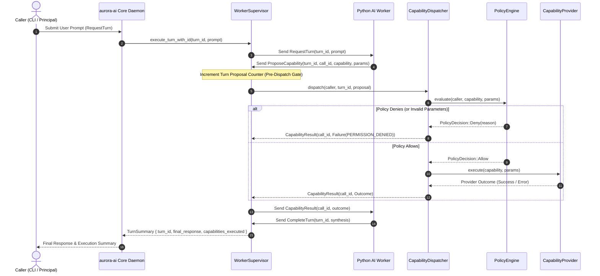

# Aurora OS Milestone 8 — Comprehensive System Audit Report

* **Status:** Complete (Milestone 8 Deliverable)
* **Date:** 2026-10-27
* **Authoritative Context:** [ADR-001](decisions/0001-core-daemon-and-worker-runtime-architecture.md), [ADR-002](decisions/0002-capability-and-permission-architecture.md), [Vertical Slice Prototype Design](vertical-slice-prototype-design.md)
* **Reference Artifacts:** [`docs/performance-baselines-m8.md`](performance-baselines-m8.md), [`docs/decisions/0003-socketpair-ipc-transport.md`](decisions/0003-socketpair-ipc-transport.md)

---

## 1. Overview & Audit Objectives

Milestone 8 performs an authoritative systems and architectural audit of the Aurora OS vertical slice prototype, evaluating the codebase against the requirements of ADR-001, ADR-002, and the prototype specification.

The audit evaluates:
1. **End-to-End Request Pipeline & Authorization Invariants:** Verification of mediation, policy enforcement, parameter validation semantics, and provider execution across all four implemented capabilities (`sys.cpu.read`, `sys.memory.read`, `proc.list`, `fs.file.read`).
2. **IPC Protocol Integrity & Failure Modes:** Directional framing, version negotiation, timeout handling, and proposal flood containment.
3. **Filesystem Confinement & Kernel Boundaries:** Strict verification of `openat2` resolution flags, regular file checks, 64 KiB read bounds, and documented limitations (hard links and worker ambient authority).
4. **Process Lifecycle, Signal Handling & Resource Cleanup:** Child process supervision, file-descriptor leak verification, and stale-socket handling.
5. **Architectural Reconciliation:** Honest accounting of discrepancies between ADR documentation and current implementation (worker recovery and fixed-path signal handling).

---

## 2. End-to-End Request Pipeline & Authorization Invariants

### 2.1 Request Lifecycle Architecture

The request flow traverses eight distinct pipeline stages:



### 2.2 Capability Invariants & Policy Enforcement Matrix

All capabilities must be registered in `CapabilityRegistry` and granted to the authenticated caller identity. Anonymous callers are rejected unconditionally.

| Capability | Parameters Checked | Execution Provider | Policy Check Mechanism | Failure Outcome |
| :--- | :--- | :--- | :--- | :--- |
| **`sys.cpu.read`** | None (empty object `{}`) | `ProcCpuProvider` (reads `/proc/stat`) | `PolicyEngine::evaluate` checks explicit caller grant. | `PERMISSION_DENIED` |
| **`sys.memory.read`** | None (empty object `{}`) | `ProcMemoryProvider` (reads `/proc/meminfo`) | `PolicyEngine::evaluate` checks explicit caller grant. | `PERMISSION_DENIED` |
| **`proc.list`** | `limit`: Integer in $[1, 1000]$ (default: 100). | `ProcListProvider` (scans `/proc/[0-9]+/stat`) | `PolicyEngine::evaluate` validates `limit` range and caller grant. | `PERMISSION_DENIED` |
| **`fs.file.read`** | `path`: Relative or absolute path.<br>`offset`: Unsigned integer $\ge 0$.<br>`length`: Integer in $[1, 65536]$. | `FsFileReadProvider` (`openat2` + `pread`) | `PolicyEngine::evaluate` validates component containment within sandbox root and caller grant. | `PERMISSION_DENIED` |

#### Semantic Boundary: `sys.cpu.read` Cumulative Metrics vs. Instantaneous Utilization
* **Cumulative Boot-to-Now Semantics:** The percentages returned by `sys.cpu.read` (`user_percent`, `system_percent`, and `idle_percent`) are calculated from a single stateless snapshot of `/proc/stat` cumulative clock tick counters since system boot. They represent lifetime aggregate proportions from boot to the current moment, **not** instantaneous utilization or short-term load.
* **Denominator Composition & Non-100% Sum:** In `crates/aurora-ai/src/provider.rs`, the denominator `total_ticks` is computed as:
  $$\text{total\_ticks} = \text{user} + \text{nice} + \text{system} + \text{idle} + \text{iowait} + \text{irq} + \text{softirq} + \text{steal}$$
  The three reported fields account only for `(user + nice)`, `(system + irq + softirq)`, and `idle`. Because `iowait` and `steal` are included in the denominator but excluded from the reported percentage categories, their sum:
  $$\text{user\_percent} + \text{system\_percent} + \text{idle\_percent} \le 100.0\%$$
  does **not** necessarily equal 100.0% when I/O wait or hypervisor steal ticks have elapsed.
* **Instantaneous Measurement Requirement:** Accurately measuring instantaneous CPU utilization requires taking multiple distinct counter snapshots across an elapsed time interval ($\Delta t$) and computing tick deltas ($\Delta \text{ticks}$). This capability prototype performs a single-snapshot cumulative read; interval-based instantaneous sampling is not implemented.

---

### 2.3 Parameter Validation Error Semantics: ADR-002 Alignment & Redundant Code

An essential architectural question investigated during M8 is whether parameter validation failures should return `PERMISSION_DENIED` or `INVALID_ARGUMENT`.

#### 1. Architectural Compliance with ADR-002
* **ADR-002 Section 3.4 & Section 3.10:** Explicitly state:
  > "Default-Deny: Any capability request not explicitly permitted by configured policy is denied with PERMISSION_DENIED."
  > "Parameter Scope Validation: Policy rules may restrict capability parameters (e.g., allowed filesystem subtrees, maximum execution timeouts). Requests exceeding parameter scope fail policy evaluation."
* In the current implementation, `CapabilityDispatcher::dispatch` routes all incoming capability proposals directly through `PolicyEngine::evaluate`.
* `PolicyEngine::evaluate` validates both capability permissions and parameter constraints (e.g., verifying that a path falls strictly within the sandbox or that an integer limit is within range).
* When a parameter violates schema constraints or sandbox scope, `PolicyEngine::evaluate` returns `PolicyDecision::Deny(DenialReason::InvalidParameterScope(...))`.
* Because the policy decision is a denial, the dispatcher immediately generates a `CapabilityOutcome::Failure { code: "PERMISSION_DENIED", ... }`.
* **Conclusion:** Returning `PERMISSION_DENIED` for parameter and scope violations is **strictly compliant** with the approved ADR-002 architectural contract.

#### 2. Code Observation: Redundant Dispatcher Fallback Branches
* In `crates/aurora-ai/src/dispatcher.rs`, following the policy authorization check, the dispatcher executes `match capability.as_str()` blocks that deserialize parameters into typed structs:
  ```rust
  let limit = match parse_limit(params) {
      Ok(l) => l,
      Err(e) => return CapabilityOutcome::Failure { code: "INVALID_ARGUMENT", ... }
  };
  ```
* Because `PolicyEngine::evaluate` has already validated parameter syntax and bounds upstream, these `parse_*` routines in the dispatcher will never encounter an invalid parameter in normal operation.
* These `INVALID_ARGUMENT` branches are currently **dead code** (unreachable in practice).
* **Recommendation:** Retain these branches as defense-in-depth fallbacks, but document that `PolicyEngine` remains the authoritative parameter validator under ADR-002.

---

## 3. IPC Protocol Integrity, Reliability & Failure Containment

### 3.1 Directional Message Framing
* The IPC protocol (`crates/aurora-protocol/src/lib.rs`) enforces strict directional framing:
  * Daemon-to-worker stream carries only `Handshake`, `RequestTurn`, and `CapabilityResult`.
  * Worker-to-daemon stream carries only `HandshakeResponse`, `ProposeCapability`, and `CompleteTurn`.
* A compromised worker attempting to send a `DaemonToWorkerMessage` (such as forging a `RequestTurn`) fails deserialization with `UnknownWorkerMessage` and terminates the connection.

### 3.2 Handshake & Version Negotiation
* On startup, the daemon supervisor sends `Handshake { protocol_version: "0.1.0", ... }`.
* The worker must respond with `HandshakeResponse { accepted: true, protocol_version: "0.1.0" }`.
* Protocol version mismatches or worker rejections result in immediate termination of the worker child process and return `SupervisorError::HandshakeFailed`.

### 3.3 Proposal Flooding Protection (M8 Implementation)
* **The Vulnerability:** Prior to M8, an untrusted or hallucinating worker could emit thousands of `ProposeCapability` messages in a tight loop within a single turn, exhausting CPU and memory in the supervisor.
* **The M8 Implementation:**
  * Introduced `max_proposals_per_turn: usize` in `SupervisorConfig` (defaulting to **20**).
  * In `WorkerSupervisor::execute_turn_with_id`, an atomic proposal counter is incremented **immediately upon receipt of each proposal**, prior to deserialization, parameter extraction, policy evaluation, or provider dispatch.
  * If a 21st proposal is received (`count > max_proposals_per_turn`), the supervisor:
    1. Rejects the turn immediately with `SupervisorError::TurnProposalLimitExceeded { count: 21, limit: 20 }`.
    2. Drops both the socket reader and writer (`self.reader = None; self.writer = None`), invalidating the IPC session.
    3. Guarantees that the excess proposal **never reaches the dispatcher or capability provider**.
* **Test Verification:** Verified by `test_turn_proposal_flood_rejection_at_limit` and `test_turn_proposal_flood_rejection_counts_pre_dispatch` in `crates/aurora-ai/tests/m8_audit_verification_tests.rs`. Both tests pass reliably.

### 3.4 Worker Recovery Discrepancy & M9 Deferral
* **ADR-001 Section 4 Rationale:**
  > "Process Boundary over In-Process FFI: Python crashes, GIL bottlenecks, or memory fragmentation cannot destabilize the aurora-ai daemon. Unhealthy workers can be terminated and restarted by the daemon supervisor."
* **Current Implementation Behavior:**
  * `WorkerSupervisor` detects child process crashes, timeouts, and framing errors. Upon detecting an error, it drops IPC channels and returns a `SupervisorError` (fail-closed behavior).
  * However, `WorkerSupervisor` does **not** currently implement an automatic worker restart loop. Once a worker session fails, subsequent `execute_turn` calls fail with `SupervisorError::SessionNotInitialized`.
* **Architectural Status:**
  * This represents an unresolved architectural discrepancy between ADR-001's design vision and the M1–M7 vertical slice implementation.
  * **Approved Decision:** Defer automatic worker restart logic to **Milestone 9**, where it can be designed natively alongside the transition to anonymous `socketpair` IPC (ADR-003). Automatic restart over filesystem-path-based Unix sockets is prone to file-locking races and stale socket cleanup issues.

---

## 4. Filesystem Confinement & Kernel Security Boundaries

### 4.1 Sandboxed File Reading Implementation (`fs.file.read`)
The `FsFileReadProvider` implements kernel-enforced sandboxing using the modern Linux `openat2` syscall:

```rust
// crates/aurora-ai/src/providers/fs.rs
let mut how = openat2::OpenHow::new();
how.flags(openat2::OFlag::O_RDONLY | openat2::OFlag::O_CLOEXEC);
how.resolve(
    openat2::ResolveFlag::RESOLVE_BENEATH
        | openat2::ResolveFlag::RESOLVE_NO_SYMLINKS
        | openat2::ResolveFlag::RESOLVE_NO_MAGICLINKS
        | openat2::ResolveFlag::RESOLVE_NO_XDEV,
);
```

#### Kernel Invariants Enforced:
1. `RESOLVE_BENEATH`: Prevents any path component from escaping the designated sandbox directory (rejects `../` directory traversals).
2. `RESOLVE_NO_SYMLINKS`: Forbids traversing symbolic links within the path, preventing symlink redirection outside the boundary.
3. `RESOLVE_NO_MAGICLINKS`: Forbids traversing procfs "magic links" (such as `/proc/self/fd/0`), preventing descriptor reuse escapes.
4. `RESOLVE_NO_XDEV`: Forbids crossing mount points (VFS filesystem boundaries).
5. **Regular File Invariant:** Following file descriptor acquisition, `fstat` verifies that `file_type.is_file()` is true. Directory descriptors, device nodes (`/dev/zero`), sockets, and FIFOs are rejected immediately.
6. **Bounded Read:** File contents are read using `pread` up to a maximum buffer limit of **64 KiB** ($65,536$ bytes).

---

### 4.2 Documented Filesystem Confinement Limitations

The audit confirms that while `openat2` provides robust VFS boundary enforcement, two structural security boundaries remain:

#### Limitation 1: Pre-Existing External Hard Links
* In Unix filesystems, a hard link is a directory entry referencing an existing inode.
* If a file within the sandbox root is created as a hard link to a file outside the sandbox (e.g., `/sandbox/secret_link` -> `/etc/shadow`), both entries share the exact same inode.
* Because `openat2` operates on VFS path resolution and does not track external link count origins, resolving `/sandbox/secret_link` with `RESOLVE_BENEATH` succeeds if the link itself is beneath the root directory.
* **Mitigation / Reality:** The sandbox root must be maintained by an administrator without pre-existing hard links from external sensitive locations.

#### Limitation 2: Worker Ambient Authority (No OS Sandboxing)
* The Python AI worker currently executes as a standard child process sharing the daemon's User ID (`UID`) without operating-system-level sandboxing (no user namespaces, no seccomp-bpf, no Landlock LSM).
* While capability proposals are strictly mediated by the daemon's dispatcher, the worker process retains the ambient operating-system authority of its executing UID.
* A compromised worker process could bypass the IPC channel entirely and directly call `open("/etc/passwd")` using standard Linux libc calls.
* **Conclusion:** Full filesystem confinement is not achieved until OS-level process sandboxing (Landlock / namespaces) is implemented in future milestones.

---

## 5. Process Lifecycle, Signal Handling & Resource Hygiene

### 5.1 File Descriptor Leak Verification
File descriptor hygiene was validated across two complementary integration test suites in `crates/aurora-ai/tests/m8_audit_verification_tests.rs`:

1. **In-Process Stream Transport (`test_descriptor_leakage_under_sustained_turns`):**
   * Validates the daemon supervisor's descriptor table (`/proc/self/fd`) under 500 sustained turns using `WorkerSupervisor::from_stream` and a thread-based mock worker.
   * Transient `/proc/self/fd` directory handles are filtered out.
   * Result: Verified daemon descriptor invariance $\Delta \mathcal{S}_{\text{daemon\_fd}} = \emptyset$.

2. **Live External Python Worker Subprocess (`test_external_python_worker_and_daemon_descriptor_leakage_under_sustained_turns`):**
   * Exercises the Rust supervisor directly within the integration-test process (`/proc/self/fd`), while launching the Python worker as a separate unprivileged child process (`/proc/<worker_pid>/fd`) via `WorkerSupervisor::start()`.
   * Captures the live child worker PID and inspects `/proc/<worker_pid>/fd` and `/proc/self/fd` in a quiescent state post-startup.
   * Executes 500 consecutive capability turns cycling across all four approved capabilities (`sys.cpu.read`, `sys.memory.read`, `proc.list`, and sandboxed `fs.file.read` via a controlled temporary sandbox fixture) using the real worker process, waiting for each turn to complete synchronously.
   * Re-evaluates quiescent descriptor snapshots after workload completion for both the live Python worker child process and the daemon/test process.
   * Compares persistent descriptor counts and link target identities, accounting for transient handles.
   * Results:
     * Live Python Worker (Child PID): Baseline 7 descriptors (stdio, socket stream, makefile reader/writer handles). Final snapshot: 7 identical descriptors. Leaked: $\emptyset$, Unexpectedly Closed: $\emptyset$ ($\Delta \mathcal{S}_{\text{worker\_fd}} = \emptyset$).
     * Daemon Supervisor (Test Process): Identical descriptor set before and after 500 turns ($\Delta \mathcal{S}_{\text{daemon\_fd}} = \emptyset$).
   * Process & Socket Cleanup: Verifies child process termination, child process reaping, and clean socket file removal on test completion.

### 5.2 Stale Socket Path Analysis & Signal Handling Deferral

#### Socket Path Computation
In `crates/aurora-ai/src/config.rs`:
```rust
pub fn socket_path(&self) -> PathBuf {
    self.socket_path.clone().unwrap_or_else(|| {
        std::env::temp_dir().join(format!("aurora-ai-{}.sock", std::process::id()))
    })
}
```

#### Behavior Under Abrupt Termination:
1. **Default Mode (PID-based path):**
   * The default socket path is constructed via `std::env::temp_dir()` and the current process ID (`aurora-ai-{PID}.sock`). While this often resolves under `/tmp` on standard Linux configurations, the actual temporary directory depends on environment variables (`$TMPDIR`, `$TEMP`, or container-specific mounts).
   * Normal clean shutdown unlinks and removes the socket file from disk. However, if the daemon terminates abruptly (via `SIGKILL`, unhandled signal, or process panic), the socket file remains as an orphaned entry in the temporary directory.
   * PID-based naming avoids bind collisions between immediate sequential or concurrent daemon launches that have different process IDs.
   * However, PID-based naming does **not** eliminate stale-file accumulation on the filesystem over time.
   * Furthermore, because operating systems allocate process IDs from a finite space, eventual PID recycling can result in a new daemon invocation receiving a PID that corresponds to an existing stale socket file, causing `UnixListener::bind` to fail with `EADDRINUSE`.
2. **Fixed Mode (`--socket-path` CLI override):**
   * When an operator provides an explicit fixed path (e.g., `--socket-path /run/aurora/ai.sock`), abrupt process termination leaves the socket file on disk.
   * On subsequent startup, `UnixListener::bind` fails immediately with `EADDRINUSE` (Address already in use), blocking startup until manual administrative intervention.
3. **Approved Decision (M9 Deferral) & Scope of Proposed ADR-003:**
   * Signal-driven cleanup (`signal-hook` / async signal handlers) for fixed paths is **deferred to Milestone 9**.
   * The long-term architectural resolution is the transition to anonymous `socketpair` IPC, as proposed in ADR-003, which will completely eliminate filesystem socket paths, filesystem race conditions, and stale-inode failure modes for worker IPC.
   * However, ADR-003 remains strictly **Proposed**; these filesystem-path risks are not eliminated until anonymous socket-pair transport is implemented in Milestone 9.

---

## 6. Comprehensive Verification Summary

| Verification Category | Test Suite / Target | Invariant Verified | Outcome |
| :--- | :--- | :--- | :---: |
| **Multi-Step Capability Chaining** | `m8_audit_verification_tests.rs` | Sequential execution of multiple capabilities (`sys.cpu.read`, `sys.memory.read`) within a single turn. | **PASSED** |
| **Proposal Flood Rejection** | `m8_audit_verification_tests.rs` | 21st proposal triggers immediate turn rejection and session invalidation; 0 excess executions. | **PASSED** |
| **Pre-Dispatch Counter Accounting** | `m8_audit_verification_tests.rs` | Unauthorized proposals count toward proposal limit; limit reached with 0 provider calls. | **PASSED** |
| **In-Process Descriptor Invariance** | `m8_audit_verification_tests.rs` | $\Delta \mathcal{S}_{\text{FD}} = \emptyset$ across 500 sustained turns (in-process stream). | **PASSED** |
| **Live External Worker FD Invariance** | `m8_audit_verification_tests.rs` | $\Delta \mathcal{S}_{\text{FD}} = \emptyset$ across 500 sustained turns on `/proc/<worker_pid>/fd` (real Python child). | **PASSED** |
| **Sustained Memory Trajectory** | `m8_audit_verification_tests.rs` | Bounded memory consumption across 1,000 sustained turns without monotonic leakage. | **PASSED** |
| **Performance Baselines** | `benches/m8_baselines.rs` | Empirical latency distributions ($p_{50}, p_{90}, p_{99}$) and throughput across 8 scenarios over 3 runs. | **PASSED** |
| **Core Daemon Test Suite** | `crates/aurora-ai` (all targets) | 188 integration and unit tests passing. | **PASSED** |
| **Python Worker Tests** | `worker/` (pytest) | 23 protocol, lifecycle, and handler tests passing. | **PASSED** |

---

## 7. Conclusions & M9 Action Items

1. **Architecture Integrity:**
   * The Aurora OS vertical slice prototype operates with high reliability, minimal IPC overhead (~61 µs median turn latency), and strict fail-closed capability mediation.
   * Parameter validation returning `PERMISSION_DENIED` is fully aligned with ADR-002.
2. **Action Items Deferred to Milestone 9:**
   * **ADR-003 Adoption:** Implement anonymous `socketpair(AF_UNIX, SOCK_STREAM, 0)` IPC transport, deprecating filesystem socket paths for internal worker communication.
   * **Worker Supervision & Restart:** Implement automatic worker restart capability conforming to ADR-001 Section 4 over the new socketpair channel.
   * **Signal-Driven Cleanup:** Implement signal handling for fixed daemon listeners or complete transition to systemd socket activation.

---

## 8. Authoritative Tracked Risk, Boundary, Caveat & Deferral Inventory

### 8.1 Inventory Reconciliation
Prior interim discussion summaries colloquially cited a count of 13 items. An exhaustive, formal cross-subsystem audit across architecture decision records, threat-model specifications, capability implementations, and benchmark baselines establishes an authoritative count of **exactly 16 tracked risk, boundary, caveat, and deferral items**.

Every item below is distinct, non-overlapping, and cross-referenced to its primary repository documentation.

### 8.2 Tracked Item Catalog

| # | Item Name | Category | Current Status | Primary References |
| :-: | :--- | :--- | :--- | :--- |
| **1** | Worker Ambient OS Authority | Security & Containment Boundary | Tracked / Future Milestone | `docs/roadmap.md` §1.3, `docs/audit-m8.md` §4.2 |
| **2** | Hard-Link Inode Sharing Limitation | Security & Filesystem Boundary | Tracked / Operational Boundary | `docs/roadmap.md` §1.5, `docs/audit-m8.md` §4.2 |
| **3** | Deferred Public IPC & Caller Authentication | Architectural Boundary & Deferral | Tracked / Future Milestone | `docs/roadmap.md` §1.2, `docs/audit-m8.md` §2.2 |
| **4** | Directory Permission Dependency (`0700`) | Security & Operational Boundary | Tracked / Operational Requirement | `docs/roadmap.md` §1.5, ADR-003 §1 |
| **5** | Post-Bind Ownership-Capture Race | Filesystem Socket Concurrency Race | Tracked / Architectural Race (Proposed ADR-003) | `docs/roadmap.md` §1.5, ADR-003 §1 |
| **6** | Shutdown Check-Then-Unlink Race | Filesystem Socket Concurrency Race | Tracked / Architectural Race (Proposed ADR-003) | `docs/roadmap.md` §1.5, ADR-003 §1 |
| **7** | Fixed-Path Stale Socket Blockage | Process Lifecycle & Operational Deferral | Tracked / Deferred to M9 | `docs/audit-m8.md` §5.2, `docs/roadmap.md` §1.5 |
| **8** | PID-Based Socket Accumulation & Reuse Collision | Process Lifecycle & Filesystem Boundary | Tracked / Environmental Limitation | `docs/audit-m8.md` §5.2, `docs/roadmap.md` §1.5 |
| **9** | Cumulative CPU-Tick Semantics of `sys.cpu.read` | Capability Semantics & Telemetry Boundary | Tracked / Documented Semantics | `docs/vertical-slice-prototype-design.md` §5.1, `docs/audit-m8.md` §2.2 |
| **10** | Missing Worker Auto-Restart / Supervision Recovery | Architectural Discrepancy & Deferral | Tracked / Deferred to M9 | `docs/audit-m8.md` §3.4, `docs/roadmap.md` §3 M8 |
| **11** | Redundant Dispatcher Parameter Validation Dead Code | Code Quality & Maintainability Caveat | Tracked / Defense-in-Depth Fallback | `docs/audit-m8.md` §2.3 |
| **12** | Workspace-Wide Formatting Backlog | Code Quality & Maintenance Backlog | Tracked / Legacy Debt | `docs/roadmap.md` §3 M7/M8 |
| **13** | Proposal Flood Side-Effect Non-Rollback | Protocol Reliability & Execution Boundary | Tracked / Inherent Protocol Boundary | `docs/audit-m8.md` §3.3 |
| **14** | Deterministic Worker Stub vs. Neural Runtime Separation | Prototype Scope Limitation | Tracked / Prototype Design Boundary | `docs/roadmap.md` §1.1, `docs/performance-baselines-m8.md` §2.2 |
| **15** | Finite RSS Profiling vs. Zero-Leak Formal Proof | Benchmark & Verification Caveat | Tracked / Empirical Observation | `docs/performance-baselines-m8.md` §4.2, `docs/audit-m8.md` §5.1 |
| **16** | Tail Latency Variance Under Virtualized Hypervisor | Performance Baseline Caveat | Tracked / Environment Limitation | `docs/performance-baselines-m8.md` §3.2, `docs/benchmarks/m8_baseline.json` |

---

### 8.3 Detailed Item Breakdown

#### Group A: Security & Kernel Containment Boundaries
1. **Worker Ambient OS Authority (No OS-Level Sandboxing):**
   * *Description:* The Python AI worker executes as a standard unprivileged child process sharing the daemon's UID without OS-level sandboxing (no user namespaces, mount namespaces, seccomp-bpf filters, or Landlock LSM rules).
   * *Risk Boundary:* While capability proposals are strictly mediated at the daemon's dispatcher boundary, the worker process retains the ambient OS authority of its executing UID and could directly access world-readable files or shared same-UID directories via native syscalls. Full isolation requires dedicated OS sandboxing in future milestones.
2. **Hard-Link Inode Sharing Limitation:**
   * *Description:* `openat2` resolution flags (`RESOLVE_BENEATH | RESOLVE_NO_SYMLINKS | RESOLVE_NO_MAGICLINKS | RESOLVE_NO_XDEV`) prevent path traversal and symlink escapes, but cannot prevent opening pre-existing hard links that reside within the sandbox root and point to external inodes.
   * *Risk Boundary:* Sandbox boundaries require administrative hygiene to ensure the sandbox root does not contain pre-existing hard links to sensitive external files.
3. **Deferred Public IPC & Production Caller Authentication:**
   * *Description:* Public D-Bus IPC, system bus interfaces, and production caller authorization mechanisms (e.g., Polkit integration, bus credentials) are deliberately deferred.
   * *Risk Boundary:* Callers in the vertical slice are represented via internal principal abstractions (`CallerIdentity`) and CLI flags. Production multi-user authentication is not yet implemented.
4. **Directory Permission Dependency (`0700`):**
   * *Description:* Security of path-based Unix domain sockets against other unprivileged system UIDs depends on operating within a private directory with mode `0700` owned by the daemon user.
   * *Risk Boundary:* The daemon does not create or validate parent directory permissions in code. It relies on operational deployment hygiene, which protects against cross-UID access but provides no defense against processes sharing the daemon's own UID.

#### Group B: Filesystem Socket Lifecycle & Concurrency Races
5. **Post-Bind Ownership-Capture Race:**
   * *Description:* On shared filesystem paths, a TOCTOU race exists between `UnixListener::bind(&path)` returning and `symlink_metadata(&path)` reading the host filesystem inode.
   * *Risk Boundary:* A concurrent same-UID process could unlink the newly bound socket and substitute another filesystem object before `symlink_metadata` executes, causing the daemon to record the replacement's inode.
6. **Shutdown Check-Then-Unlink Race:**
   * *Description:* On shared filesystem paths, a TOCTOU race exists between `symlink_metadata(&path)` checking the socket inode on shutdown and `std::fs::remove_file(&path)` executing `unlink()`.
   * *Risk Boundary:* A concurrent same-UID process could replace the socket with another file after the metadata check, causing the daemon to unlink the replacement file. Linux provides no atomic `unlink_if_matches` syscall.
7. **Fixed-Path Stale Socket Blockage Under Abrupt Termination:**
   * *Description:* When an operator configures an explicit fixed path via `--socket-path`, abrupt process termination (`SIGKILL`, unhandled signal, crash) leaves an orphaned socket file on disk.
   * *Risk Boundary:* Subsequent daemon startup fails immediately with `EADDRINUSE` until manual administrative intervention unlinks the stale socket file. Signal-driven cleanup is deferred to M9.
8. **PID-Based Socket Accumulation & Eventual PID Reuse Collision:**
   * *Description:* Default socket paths are constructed using `std::env::temp_dir()` and the process ID (`aurora-ai-{PID}.sock`), resolving typically to `/tmp`. Abrupt termination leaves orphaned socket files in the temporary directory.
   * *Risk Boundary:* While PID-based naming prevents collisions between immediate launches with different PIDs, stale files accumulate over time. Because the OS PID space is finite, eventual PID recycling can result in a new daemon invocation receiving a PID that corresponds to an existing stale socket file, causing `bind` to fail with `EADDRINUSE`. Proposed ADR-003 will eliminate this when implemented in M9, but remains Proposed today.

#### Group C: Capability Semantics & Telemetry Boundaries
9. **Cumulative CPU-Tick Semantics of `sys.cpu.read`:**
   * *Description:* Metrics returned by `sys.cpu.read` (`user_percent`, `system_percent`, `idle_percent`) are computed from a single stateless snapshot of `/proc/stat` cumulative clock ticks since system boot.
   * *Risk Boundary:* The values represent boot-to-now lifetime shares, not instantaneous utilization. The denominator includes `iowait` and `steal`, while the three reported categories omit them, so their sum does not necessarily equal 100.0%. Instantaneous load calculation requires multi-sample interval measurement, which is not implemented in this prototype.

#### Group D: Process Supervision, Lifecycle & Deferrals
10. **Missing Worker Auto-Restart / Supervision Recovery:**
    * *Description:* ADR-001 Section 4 envisioned that unhealthy workers would be terminated and automatically restarted by the daemon supervisor.
    * *Risk Boundary:* The current implementation detects failures and fails closed, dropping IPC channels and returning errors without restarting the worker. Automatic worker restart is deferred to M9 alongside anonymous socketpair transport.
11. **Redundant Dispatcher Parameter Validation Dead Code:**
    * *Description:* `CapabilityDispatcher` contains fallback `match` deserialization branches that return `INVALID_ARGUMENT`.
    * *Risk Boundary:* Because `PolicyEngine::evaluate` validates parameter syntax and scope upstream and returns `PERMISSION_DENIED` per ADR-002 §3.4/§3.10, these dispatcher fallback branches are unreachable dead code in normal operation.
12. **Workspace-Wide Formatting Backlog:**
    * *Description:* Legacy Rust source files from M1–M6b do not conform to `cargo fmt --all -- --check`.
    * *Risk Boundary:* Workspace-wide automated formatting cannot be enforced in CI without massive churn across historical commits. Formatting enforcement is strictly targeted to new and modified M7/M8 files.

#### Group E: Protocol Reliability, Performance & Verification Caveats
13. **Proposal Flood Side-Effect Non-Rollback:**
    * *Description:* The supervisor's proposal flood gate rejects the turn and terminates the IPC session immediately upon receipt of proposal 21 (pre-dispatch).
    * *Risk Boundary:* Capability proposals 1–20 executed prior to the flood limit may have produced side effects or read system state. These prior effects cannot be rolled back upon session termination.
14. **Deterministic Worker Stub vs. Neural Runtime Separation:**
    * *Description:* The AI worker stub uses deterministic rule-based mappings to simulate reasoning.
    * *Risk Boundary:* No real LLM, neural network weights, tokenizer, or inference runtime has been integrated. Real model latency, GPU memory footprint, and token streaming dynamics remain uncharacterized.
15. **Finite RSS Profiling vs. Zero-Leak Formal Proof:**
    * *Description:* Memory stability was sampled at checkpoints ($M_0, M_{50}, M_{100}, M_{500}, M_{1000}$) across 1,000 sustained turns.
    * *Risk Boundary:* While empirical observation showed stable resident memory (2.7–2.9 MiB daemon, 16.2–16.3 MiB worker) without monotonic growth, finite-turn sampling is an empirical baseline, not a formal mathematical proof of zero long-term memory leakage.
16. **Tail Latency Variance Under Virtualized Hypervisor:**
    * *Description:* Turn latencies were benchmarked across 3 runs of 1,000 samples per scenario on virtualized hardware.
    * *Risk Boundary:* Tail latencies ($p_{90}, p_{99}$) exhibit variability due to hypervisor CPU scheduling jitter, vCPU migration, and shared host VFS cache state. Microsecond-level baselines reflect the virtualized test environment.
