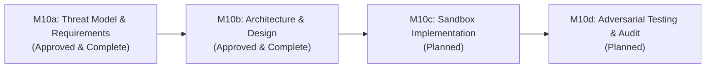

# Milestone 10b Plan: Sandbox Architecture and Design

* **Plan Status:** Approved
* **Execution Status:** Complete
* **Date:** 2026-11-21 / 2026-11-23
* **Authoritative Architecture Context:**
  - [ADR-001: Core Daemon Language, Initial Worker Runtime, and Process Boundary](../../decisions/0001-core-daemon-and-worker-runtime-architecture.md)
  - [ADR-002: Capability and Permission Architecture](../../decisions/0002-capability-and-permission-architecture.md)
  - [ADR-003: Anonymous Socketpair IPC Transport](../../decisions/0003-socketpair-ipc-transport.md)
  - [ADR-004: Operating-System-Level Sandboxing and Confinement for AI Worker Processes](../../decisions/0004-worker-os-sandboxing-and-process-isolation.md)
  - [Milestone 10b Architecture and Design Specification](../../architecture/m10b-sandbox-design.md)
  - [Milestone 10a Plan](m10a-plan.md)
  - [AI Worker Threat Model](../../security/worker-threat-model.md)
  - [Worker Security & Sandbox Requirements](../../security/worker-sandbox-requirements.md)
  - [Aurora OS Implementation Roadmap](../../roadmap.md)

---

## 1. Milestone Overview & Purpose

Milestone 10a established the authoritative Threat Model and ten formal Security Requirements (SEC-REQ-01 through SEC-REQ-10) for the Aurora OS Python AI worker under assumed complete Arbitrary Code Execution (ACE).

The purpose of **Milestone 10b (Sandbox Architecture and Design)** is to formulate a comprehensive, technically consistent, and implementable system design that satisfies all ten security requirements while preserving existing Milestone 1–9 capabilities, IPC transport framing (ADR-003), and lifecycle recovery contracts.

The governing **Milestone 10 Security Invariant** is:

> **"If the Python AI worker is completely compromised, it must not gain unrestricted access to the host system. It must operate within an explicitly defined, operating-system-enforced security boundary."**

Milestone 10b transitions this invariant from abstract requirements into an authoritative architectural blueprint ready for implementation in Milestone 10c.

---

## 2. Planning Objectives

The core objectives of Milestone 10b were:

1. **Evaluate Architectural Trade-offs Across Workstreams A–H**: Perform deep technical investigations across trusted launcher architecture, filesystem confinement, syscall filtering, resource containment, descriptor hygiene, network disconnection, process isolation, and external verification.
2. **Select and Ratify the Optimal Architecture**: Compare In-Daemon Launcher (Option A), External Container Engine (Option B), and Native Rust Launcher + Cgroup v2 (Option C), leading to the formal ratification of **Option C**.
3. **Formalize ADR-004**: Author and accept [ADR-004](../../decisions/0004-worker-os-sandboxing-and-process-isolation.md) establishing Option C as project policy.
4. **Produce the Standalone Architecture Specification**: Consolidate all architectural decisions, syscall rules, namespace configurations, and lifecycle handshakes into a permanent, comprehensive engineering specification ([`docs/architecture/m10b-sandbox-design.md`](../../architecture/m10b-sandbox-design.md)).
5. **Resolve Technical & Lifecycle Errata**: Rigorously resolve multi-process race conditions, PID 1 signal semantics, parent-death synchronization, Landlock ABI v4 single-threaded invariants, x32 ABI rejection, `clone3` glibc fallback, and inherited descriptor cleanup.
6. **Establish Multi-Environment Compatibility Matrix**: Define precise behavior and safe refusal policies across Linux production desktop targets and containerized developer environments.
7. **Define Implementation Phasing for M10c**: Structure the implementation into four sequential, verifiable phases.

---

## 3. Scope and Explicit Non-Goals

### 3.1 In-Scope
* Architectural design and trade-off evaluation across Workstreams A through H.
* Formulation and formal acceptance of [ADR-004](../../decisions/0004-worker-os-sandboxing-and-process-isolation.md).
* Creation of the complete [M10b Architecture Specification](../../architecture/m10b-sandbox-design.md).
* Updating the ADR Index ([`docs/decisions/README.md`](../../decisions/README.md)) and Implementation Roadmap ([`docs/roadmap.md`](../../roadmap.md)).
* Preservation of this approved plan in `docs/plans/m10/m10b-plan.md`.

### 3.2 Explicit Non-Goals (Enforced Restrictions)
* **No Implementation Code**: No creation or editing of Rust or Python source code.
* **No Dependency Additions**: Zero changes to `Cargo.toml`, `Cargo.lock`, or Python packages.
* **No Premature Commencement**: No execution of Milestone 10c (Implementation) or 10d (Audit).
* **No Modification of Prior Decisions**: ADR-001, ADR-002, and ADR-003 remain untouched.
* **No Modification of M10a Documents**: M10a threat model and requirement specifications remain frozen.

---

## 4. Approved Architecture: Option C (Hybrid Architecture)

Aurora OS formally approves **Option C: Native Rust Trusted Launcher + Systemd-Assisted Cgroup v2 Resource Management**, structured around a **three-tier process hierarchy**:

$$\text{aurora-ai (WorkerSupervisor)} \longrightarrow \text{aurora-worker-launcher} \longrightarrow \text{Python AI Worker (PID 1)}$$

* **Supervisor (`aurora-ai`)**: Owns and supervises `aurora-worker-launcher` via `std::process::Child`. Manages socketpair IPC, attaches the launcher PID to a systemd transient scope via D-Bus, and executes the shutdown escalation ladder.
* **Trusted Launcher (`aurora-worker-launcher`)**: A standalone, minimal native Rust binary executing sequentially on a single thread. Establishes namespaces, constructs a minimal rootfs, applies Landlock ABI v4 and Seccomp Stage 1, forks the worker, acts as an unprivileged reaper proxy, and mirrors exit codes and signals to the supervisor.
* **Python AI Worker**: Forks into a new PID namespace as PID 1. Runs trusted bootstrap (`python3 -I -S -B`), applies Seccomp Stage 2 sealing via `aurora_seal`, registers a SIGTERM handler, and processes inference requests over the inherited socketpair.

---

## 5. Architectural Workstreams A–H Summary

Milestone 10b conducted focused investigations across eight workstreams:

1. **Workstream A: Trusted Launcher Architecture**:
   - Compared in-daemon `pre_exec` forks, standalone C launcher, and standalone native Rust launcher.
   - Selected standalone Rust launcher: provides memory safety, eliminates Tokio `pre_exec` async-signal-safety deadlocks, and satisfies Landlock ABI v4 single-threaded invariants.
2. **Workstream B: Local Filesystem Confinement**:
   - Replaced weak `chroot` with atomic `pivot_root` into a private tmpfs rootfs, detaching the host VFS via `MNT_DETACH`.
   - Read-only bind mounts on `/usr`, `/lib`, `/lib64`, and `/app`.
   - Minimal `/dev` tmpfs with bind-mounted `/dev/null`, `/dev/zero`, `/dev/urandom`.
   - Procfs mounted with `subset=pid` to eliminate global telemetry leaks (`/proc/stat`, `/proc/meminfo`).
   - Scoped Landlock ABI v4 ruleset restricting `EXECUTE` strictly to `/usr/bin/python3` and the dynamic linker.
3. **Workstream C: System Call Filtering (Seccomp-BPF)**:
   - Designed a progressive two-stage Seccomp architecture.
   - Resolved `clone3` by returning `ENOSYS`, triggering glibc's internal fallback to classic `clone(2)`.
   - Filtered `clone(2)`: verified upper 32 bits are zero, mandated `CLONE_THREAD` and companion flags, rejected process forks and namespace creation flags, and required exit signal 0.
   - Explicitly rejected the x32 ABI via `__X32_SYSCALL_BIT` inspection.
   - Denied `io_uring`, `SYS_socket`, `SYS_socketpair`, and message-based socket calls (`sendmsg`, `recvmsg`, `sendmmsg`, `recvmmsg`) to eliminate `SCM_RIGHTS` descriptor smuggling.
   - Stage 2 permanently seals `SYS_execve` and `SYS_execveat` post-bootstrap using `SECCOMP_FILTER_FLAG_TSYNC`.
4. **Workstream D: Resource Containment & Cgroup v2**:
   - Established cgroup v2 as the authoritative per-worker limiter (`memory.max=512M`, `pids.max=32`, `cpu.max=100%`).
   - Rejected `RLIMIT_NPROC` due to its per-real-UID system-wide scope.
   - Implemented a startup gate: launcher blocks until supervisor confirms cgroup attachment via systemd D-Bus.
   - Formulated dual-mode policy: strict mode safely refuses startup if mandatory controls are missing; permissive mode activates fallback rlimits (`RLIMIT_CORE=0`, `RLIMIT_NOFILE=64`, `RLIMIT_FSIZE=100M`) and tmpfs 128M quota.
5. **Workstream E: Inherited Descriptor & Channel Control**:
   - Established authoritative 7-stage FD ownership manifest (FD 0 through 9).
   - Invariant: Launcher immediately closes worker-side IPC socket (FD 0) post-fork, ensuring worker is the sole possessor and preserving EOF delivery upon supervisor shutdown.
   - Post-pivot purge: `close_range(10, UINT_MAX, 0)` eliminates all setup descriptors ($\ge 10$) prior to application execution, followed by staged closure of FD 4 (post-gate), FD 6–9 (post-pdeath sync), FD 3 (via `O_CLOEXEC` on `execve`), and FD 5 (post-bootstrap ack).
   - Redirected FD 2 to a bounded asynchronous stderr logging pipe, eliminating `TIOCSTI` terminal injection.
6. **Workstream F: Network Disconnection**:
   - Unshared network namespace (`CLONE_NEWNET`) with loopback (`lo`) left down.
   - Seccomp blocks `SYS_socket` and `SYS_socketpair`; Landlock restricts TCP bind/connect.
7. **Workstream G: Process Isolation & Supervision**:
   - Confined PID namespace (`CLONE_NEWPID`) with worker as PID 1.
   - Addressed PID 1 signal semantics: worker explicitly registers SIGTERM handler in bootstrap; launcher forwards signals and preserves M9 fallback escalation to SIGKILL.
   - Two-way parent-death protection: worker arms `PR_SET_PDEATHSIG(SIGKILL)` after credential drops, exchanges `TOKEN_ARMED`/`TOKEN_CONTINUE` with launcher, closing the fork-to-prctl race without relying on `getppid()`.
   - Worker protected from same-UID external tracing via `PR_SET_DUMPABLE(0)`.
8. **Workstream H: Verification & Failure Handling**:
   - Four-event startup progression: Gate $\to$ Sandbox Ready $\to$ Execve EOF $\to$ Bootstrap Ack $\to$ Handshake Ready.
   - Temporary `boot_ack_fd` (FD 5) closed post-bootstrap, cleanly distinguishing pre-exec crashes from successful interpreter entry.
   - Preserved exact M9 shutdown escalation timings (200 ms EOF $\to$ 300 ms SIGTERM $\to$ SIGKILL).

---

## 6. Decisions and Alternatives Evaluated

| Alternative | Evaluation Summary | Final Disposition |
| :--- | :--- | :--- |
| **Option A: In-Daemon Launcher** | Spawning directly from Tokio daemon risks POSIX async-signal-safety deadlocks; fails Landlock ABI v4 multithreading requirements. | **Rejected** |
| **Option B: External Container Engine** | Podman/bubblewrap/`systemd-run` wrappers add heavy dependencies, startup latency, and break direct `std::process::Child` supervision. | **Rejected** |
| **Option C: Native Rust Launcher + Cgroup v2** | Rootless, single-threaded, async-signal-safe, integrates cleanly with systemd D-Bus, preserves direct child management. | **Approved** |
| **Python In-Process Sandbox** | Language-level guardrails provide zero protection against ACE or raw syscalls. | **Rejected** |
| **`chroot` Alone** | Does not alter mount namespace; escapable inside user namespaces. | **Rejected (pivot_root adopted)** |
| **`RLIMIT_NPROC`** | Linux restricts processes per real-UID system-wide, breaking daemon threads in rootless environments. | **Rejected (cgroup pids.max adopted)** |
| **Ordinary /proc Mount** | Leaks host telemetry (`/proc/stat`, `/proc/meminfo`), bypassing capability delegation. | **Rejected (subset=pid adopted)** |

---

## 7. Expected Deliverables & Status

| Deliverable | Location | Status |
| :--- | :--- | :--- |
| **ADR-004** | [`docs/decisions/0004-worker-os-sandboxing-and-process-isolation.md`](../../decisions/0004-worker-os-sandboxing-and-process-isolation.md) | **Accepted** |
| **ADR Index Update** | [`docs/decisions/README.md`](../../decisions/README.md) | **Complete** |
| **M10b Architecture Specification** | [`docs/architecture/m10b-sandbox-design.md`](../../architecture/m10b-sandbox-design.md) | **Complete** |
| **Milestone 10b Plan Record** | [`docs/plans/m10/m10b-plan.md`](m10b-plan.md) | **Complete** |
| **Roadmap Update** | [`docs/roadmap.md`](../../roadmap.md) | **Complete** |

---

## 8. Acceptance Criteria

Milestone 10b achieves full completion under these verified criteria:
1. **Architectural Completeness**: The specification thoroughly addresses all ten security requirements (SEC-REQ-01 to SEC-REQ-10) with exact syscall sequences, flag masks, and path matrices.
2. **Technical Consistency**: All lifecycle handshakes, pipe directions, descriptor tables, and PID 1 signal interactions are fully resolved without contradictions.
3. **Formal Approval**: ADR-004 is ratified and marked Accepted.
4. **Roadmap & Plan Synchronization**: Roadmap and plan records accurately document the milestone state.
5. **Zero Implementation Creep**: Working tree is verified clean of source code edits or dependency modifications.

---

## 9. Dependencies and Prerequisites

* **Milestone 10a**: Threat model and sandbox requirements established and frozen.
* **Host Kernel Primitives**: Linux kernel supporting `CLONE_NEWUSER`, `CLONE_NEWNS`, `CLONE_NEWPID`, `CLONE_NEWNET`, Landlock ABI $\ge 4$, and Seccomp-BPF.
* **Rust Toolchain**: Standard Rust compiler for standalone launcher development in M10c.
* **Python Runtime**: Python $\ge 3.10$ for modern `importlib.util` module loading.

---

## 10. Risks and Implementation-Time Validation Requirements

The following empirical validation items are carried into Milestone 10c (Implementation) and Milestone 10d (Audit):
1. **Glibc Arena Virtual Memory Tuning**: Under multithreaded inference, glibc's `ptmalloc` allocates 64 MiB arenas per thread. In M10c, evaluate `MALLOC_ARENA_MAX=2` to ensure virtual memory bloat does not challenge memory bounds.
2. **Empirical Stderr Pipe Drainage**: Validate that the supervisor's asynchronous Tokio reader drains FD 2 continuously without latency under sustained 1,000 line/sec log bursts.
3. **Cgroup Scope Timing**: Measure the exact latency of systemd D-Bus `StartTransientUnit` during worker startup to verify cold-start targets ($\le 50$ ms).
4. **Strace Syscall Verification**: Capture empirical strace runs of `socket.sendall()`, `recv()`, and `close()` under Seccomp Stage 2 to confirm no unwhitelisted auxiliary syscalls are invoked by newer glibc/Python minor versions.

---

## 11. Relationship with ADR-001 through ADR-004

* **ADR-001**: Reinforces the language and process boundary by introducing an external operating-system-enforced confinement perimeter around the Python runtime.
* **ADR-002**: Protects the capability architecture: worker cannot bypass capability dispatching through direct host VFS or procfs scraping.
* **ADR-003**: Preserves the anonymous socketpair IPC transport and 512 KiB framing protocol without alteration.
* **ADR-004**: Formally establishes the sandbox architecture designed herein.

---

## 12. Relationship with M10a, M10c, and M10d

* **M10a (Threat Model & Requirements)**: Formulated the foundation; completed and frozen.
* **M10b (Architecture & Design)**: Translated requirements into the approved system specification; completed and closed.
* **M10c (Sandbox Implementation)**: Will construct the launcher crate, Seccomp BPF filters, Landlock rulesets, and supervisor integration.
* **M10d (Adversarial Testing & Audit)**: Will execute the internal penetration test suite and verify regression safety.

---

*End of Milestone 10b Plan.*
