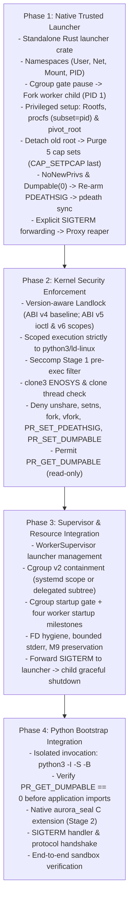

# Milestone 10c Plan: Sandbox Implementation

* **Plan Status:** Approved
* **Execution Status:** Phase 1 Authorized; Phase 1 Not Yet Started
* **Authorization Note:** Phase 1 has been explicitly authorized for execution; subsequent phases remain subject to sequential gating.
* **Date:** 2026-11-23
* **Authoritative Architecture Context:**
  - [ADR-001: Core Daemon Language, Initial Worker Runtime, and Process Boundary](../../decisions/0001-core-daemon-and-worker-runtime-architecture.md)
  - [ADR-002: Capability and Permission Architecture](../../decisions/0002-capability-and-permission-architecture.md)
  - [ADR-003: Anonymous Socketpair IPC Transport](../../decisions/0003-socketpair-ipc-transport.md)
  - [ADR-004: Operating-System-Level Sandboxing and Confinement for AI Worker Processes](../../decisions/0004-worker-os-sandboxing-and-process-isolation.md)
  - [Milestone 10b Sandbox Architecture and Design Specification](../../architecture/m10b-sandbox-design.md)
  - [AI Worker Threat Model](../../security/worker-threat-model.md)
  - [Worker Security & Sandbox Requirements](../../security/worker-sandbox-requirements.md)
  - [Milestone 10a Plan](m10a-plan.md)
  - [Milestone 10b Plan](m10b-plan.md)
  - [Aurora OS Implementation Roadmap](../../roadmap.md)

---

## 1. Executive Summary & Security Invariant

Milestone 10c implements the accepted Option C sandbox architecture ([ADR-004](../../decisions/0004-worker-os-sandboxing-and-process-isolation.md)) and the authoritative design specification ([`docs/architecture/m10b-sandbox-design.md`](../../architecture/m10b-sandbox-design.md)) in production-grade code.

The governing **Milestone 10 Security Invariant** is:

> **"If the Python AI worker is completely compromised, it must not gain unrestricted access to the host system. It must operate within an explicitly defined, operating-system-enforced security boundary."**

### 1.1 Scope and Production Status Qualifications
- **Implementation Scope (M10c)**: Milestone 10c builds, integrates, and verifies the trusted native launcher, kernel security enforcement (Landlock + Seccomp Stage 1 & 2), cgroup v2 resource containment, and the isolated Python bootstrap runtime.
- **Verification Scope (M10d)**: Milestone 10d remains formally responsible for comprehensive adversarial penetration testing, exploit simulation, and external security auditing. Completion of Milestone 10c implements the architecture but **does not claim independent production security certification** prior to M10d completion.
- **Controlled Test Workloads**: Phase 1 and Phase 2 test suites may use controlled, lightweight dummy probe child processes to verify primitive boundaries. Actual AI application workloads are **strictly prohibited** from executing as production workers until all four mandatory sandbox phases are completed and integrated.

---

## 2. Phased Implementation Structure

To maintain absolute architectural safety, Milestone 10c proceeds across four strictly sequential phases:



No phase may begin until the preceding phase satisfies all acceptance criteria and passes verification tests.

---

## 3. Phase 1 — Native Trusted Launcher

### 3.1 Objectives
1. Construct the standalone native Rust executable `aurora-worker-launcher` in `crates/aurora-worker-launcher`.
2. Implement rootless Linux namespaces: `CLONE_NEWUSER`, `CLONE_NEWNET`, `CLONE_NEWNS`, `CLONE_NEWPID`.
3. Establish UID/GID mapping (container UID/GID 1000) with mandatory `setgroups` denial.
4. Enforce strict capability, cgroup gate, and lifecycle ordering, distinguishing launcher setup privileges from the final worker privilege state:
   - **Step 1 (Namespaces & ID Mapping)**: Unshare user, net, and mount namespaces. Deny `setgroups`, write `uid_map` and `gid_map` mapping host UID/GID to container UID/GID 1000. Unshare PID namespace (`CLONE_NEWPID`).
   - **Step 2 (Cgroup Startup Gate Pause)**: Before forking the worker child, the launcher pauses at the FD 4 startup gate (`read(gate_read, 1)`). The supervisor places the launcher PID into the per-worker cgroup (systemd transient scope or delegated cgroup subtree), confirms active controllers, and releases the gate by writing token `0x01` (`GATE_CONTINUE`). The launcher reads the token and closes FD 4.
   - **Step 3 (Worker Child Fork — PID 1 in ns)**: The launcher calls `fork()`. The first child process created after `CLONE_NEWPID` unsharing is born as **PID 1** in the new PID namespace. Crucially, the worker child automatically **inherits the already-established cgroup placement and resource constraints** from the launcher.
   - **Step 4 (Child Privileged Rootfs & Procfs Construction)**:
     - Worker child unshares an independent mount namespace (`unshare(CLONE_NEWNS)` with `MS_REC | MS_PRIVATE`).
     - Retains user-namespace-scoped setup capabilities (`CAP_SYS_ADMIN`, `CAP_SYS_CHROOT`, `CAP_SETPCAP`).
     - Assembles sandbox root tmpfs (`size=64M,mode=0755,nosuid,nodev`).
     - Constructs mount directory skeleton (`/usr`, `/lib`, `/lib64`, `/bin`, `/dev`, `/proc`, `/tmp`, `/app`, `/put_old`).
     - Mounts read-only bind mounts on `/usr`, `/lib`, `/lib64`, and `/app` (`MS_RDONLY | MS_NODEV | MS_NOSUID`).
     - Mounts minimal `/dev` tmpfs (`/dev/null` R/W, `/dev/zero` RO, `/dev/urandom` RO, symlink `random -> urandom`).
     - Mounts scratch storage at `/tmp` (`size=128M,mode=0700,nosuid,nodev,noexec`).
     - **Mounts Private Procfs with `subset=pid`**: Executes `mount("proc", "/proc", "proc", MS_NODEV | MS_NOSUID | MS_NOEXEC, "subset=pid")` while `CAP_SYS_ADMIN` is effective. Strict mode safely refuses startup (`ERR_PROCFS_SUBSET_PID_UNSUPPORTED`) if `subset=pid` is unsupported; permissive mode falls back to masking (`/dev/null` bind-mounted over `/proc/stat`, `/proc/meminfo`, `/proc/cpuinfo`).
     - Executes `pivot_root(sandbox_root, put_old)` and `chdir("/")`.
     - Detaches the old root via `umount2("/put_old", MNT_DETACH)` and removes `/put_old`.
   - **Step 5 (Strict Capability Purge Order & `CAP_SETPCAP` Retention)**:
     - Retains `CAP_SETPCAP` in the effective capability set until bounding set operations are complete.
     - Clears ambient capabilities: `prctl(PR_CAP_AMBIENT, PR_CAP_AMBIENT_CLEAR_ALL, 0, 0, 0)`.
     - Drops every capability from the bounding set: loops from `0` to `CAP_LAST_CAP` calling `prctl(PR_CAPBSET_DROP, cap, 0, 0, 0)` while `CAP_SETPCAP` remains effective.
     - Clears effective, permitted, and inheritable sets via `capset()` with zeroed 64-bit capability masks.
     - Verifies all five capability sets (bounding, ambient, inheritable, effective, permitted) are completely empty.
   - **Step 6 (Privilege Lock & Anti-Tracing)**:
     - Applies `prctl(PR_SET_NO_NEW_PRIVS, 1, 0, 0, 0)` to permanently block privilege escalation.
     - Applies `prctl(PR_SET_DUMPABLE, 0, 0, 0, 0)` to prevent same-UID ptrace attachment and core dump memory leakage.
   - **Step 7 (Parent-Death Re-establishment & Handshake)**:
     - Re-establishes `prctl(PR_SET_PDEATHSIG, SIGKILL)` targeting the launcher process. (Explicitly closing the Linux kernel behavior where credential and capability transitions reset `PDEATHSIG` to 0).
     - Executes the two-way parent-death synchronization handshake (`TOKEN_ARMED` on `pdeath_c2l` $\to$ `TOKEN_CONTINUE` on `pdeath_l2c`), confirming launcher liveness.
   - **Step 8 (Proxy Reaping & Explicit Signal Forwarding)**:
     - Launcher closes its worker-side IPC socket (FD 0) post-fork.
     - Launcher monitors for termination signals from the supervisor. Upon receiving `SIGTERM`, launcher explicitly forwards `SIGTERM` to the worker child process ($P_w$), allowing the worker's registered SIGTERM handler to perform graceful shutdown.
     - Launcher blocks in `waitpid(Pw, &status, 0)` and mirrors the worker's exit status (`exit(WEXITSTATUS(status))`) or terminating signal (`raise(WTERMSIG(status))`).

### 3.2 Exact Expected Deliverables
- `crates/aurora-worker-launcher/Cargo.toml`: Minimal standalone crate definition.
- `crates/aurora-worker-launcher/src/main.rs`: Sequential setup orchestrator.
- `crates/aurora-worker-launcher/src/ns.rs`: Namespace unsharing and management.
- `crates/aurora-worker-launcher/src/idmap.rs`: User namespace UID/GID mapping and setgroups denial.
- `crates/aurora-worker-launcher/src/rootfs.rs`: Tmpfs root assembly, read-only bind mounts, minimal `/dev`, scratch `/tmp`, private procfs (`subset=pid`), `pivot_root`, and old-root detachment.
- `crates/aurora-worker-launcher/src/caps.rs`: Ordered 5-set capability purge with `CAP_SETPCAP` retention, `NoNewPrivs`, and `PR_SET_DUMPABLE(0)`.
- `crates/aurora-worker-launcher/src/pdeath.rs`: Post-credential `PR_SET_PDEATHSIG` establishment and two-way parent-death synchronization protocol (`pdeath_c2l`, `pdeath_l2c`).
- `crates/aurora-worker-launcher/src/reaper.rs`: Signal-forwarding reaper proxy loop: catches `SIGTERM` from supervisor, forwards to worker child, waits via `waitpid`, and mirrors exit code or signal.
- `crates/aurora-worker-launcher/tests/launcher_isolation_tests.rs`: Integration tests for Phase 1 primitives using controlled dummy probe processes.
- Workspace `Cargo.toml`: Addition of `crates/aurora-worker-launcher` to workspace members.

### 3.3 Proposed Source Files
- `crates/aurora-worker-launcher/Cargo.toml`
- `crates/aurora-worker-launcher/src/main.rs`
- `crates/aurora-worker-launcher/src/ns.rs`
- `crates/aurora-worker-launcher/src/idmap.rs`
- `crates/aurora-worker-launcher/src/rootfs.rs`
- `crates/aurora-worker-launcher/src/caps.rs`
- `crates/aurora-worker-launcher/src/pdeath.rs`
- `crates/aurora-worker-launcher/src/reaper.rs`
- `crates/aurora-worker-launcher/tests/launcher_isolation_tests.rs`
- `Cargo.toml` (workspace root update)

### 3.4 Dependencies
- Internal: None.
- External: `libc = "0.2"`. Zero async executors or multithreading runtimes.

### 3.5 Security Invariants
- Launcher executes strictly on a single operating system thread.
- User namespace disables `setgroups` before mapping GIDs.
- Launcher waits at the cgroup startup gate before forking the worker child; worker child inherits the verified cgroup limits.
- Worker child is born as PID 1 in the new PID namespace.
- Procfs is mounted with `subset=pid` while `CAP_SYS_ADMIN` is effective, before capability purging.
- `CAP_SETPCAP` is retained during bounding set drops and removed only during final `capset` clearing.
- All five capability sets are verified completely zeroed before moving to the execution boundary.
- `PR_SET_PDEATHSIG(SIGKILL)` is re-armed after all credential and capability modifications.
- Launcher explicitly forwards `SIGTERM` to worker child before reaping.
- `NoNewPrivs` locked permanently prior to worker execution.
- Host root completely detached via `pivot_root` and `MNT_DETACH`.
- Network namespace contains 0 interfaces; loopback is DOWN.
- Strict mode fails closed if `subset=pid` is unsupported.

### 3.6 Tests and Verification
- Unit and integration tests in `launcher_isolation_tests.rs` using controlled dummy probe processes:
  - Verify launcher halts at startup gate on FD 4 and resumes only upon token reception.
  - Verify worker child is PID 1 in its namespace and inherits parent's cgroup.
  - Verify UID/GID inside container maps to 1000.
  - Verify capability status in `/proc/self/status` shows zeroes across all 5 sets (`CapInh`, `CapPrm`, `CapEff`, `CapBnd`, `CapAmb`).
  - Verify `NoNewPrivs: 1` and `Dumpable: 0` in `/proc/self/status`.
  - Verify `/proc/stat` and `/proc/meminfo` return `ENOENT` inside sandbox.
  - Verify filesystem outside whitelist paths returns `ENOENT` or `EACCES`.
  - Verify launcher forwards `SIGTERM` to child and mirrors exit status 143 upon clean child termination.
  - Verify parent-death handshake completes reliably without deadlock.

### 3.7 Acceptance Criteria
- `cargo build -p aurora-worker-launcher` succeeds with zero warnings.
- `launcher_isolation_tests` pass 100%.
- Working tree clean of unapproved changes.

### 3.8 Dependencies on Preceding Phases
- None (baseline foundational phase).

### 3.9 Explicit Non-Goals
- No Landlock or Seccomp syscall filtering (Phase 2).
- No Cgroup v2 integration or D-Bus systemd scope (Phase 3).
- No Python bootstrap or `aurora_seal` integration (Phase 4).
- No execution of actual AI application workloads.

---

## 4. Phase 2 — Kernel Security Enforcement

### 4.1 Objectives
1. Implement version-aware Landlock LSM ruleset enforcement:
   - Dynamic runtime probing via `landlock_create_ruleset(NULL, 0, LANDLOCK_CREATE_RULESET_VERSION)`.
   - **Baseline (ABI v4)**: Minimum supported production baseline. Enforces complete ABI v4 rights: 15 filesystem access rights and 2 TCP network rights (`BIND_TCP`, `CONNECT_TCP`).
   - **Scoped Binary Execution**: `LANDLOCK_ACCESS_FS_EXECUTE` is granted **strictly and exclusively** to `/usr/bin/python3` and the dynamic linker `/lib64/ld-linux*`. Execution from `/tmp`, `/dev`, or library directories is explicitly denied.
   - **Read-Only Paths**: Granted to `/lib`, `/lib64`, `/usr/lib`, and `/app`.
   - **Writable Paths**: Restricted strictly to `/tmp` (scratch) and `/dev/null`.
   - **ABI v5+ Awareness (`LANDLOCK_ACCESS_FS_IOCTL_DEV`)**: When ABI $\ge 5$ is detected, include device ioctl handling in `handled_access_fs`, restricting device ioctls strictly to approved standard devices (`/dev/null`, `/dev/zero`, `/dev/urandom`). On ABI v4, device ioctl safety is independently enforced by our minimal `/dev` tmpfs and Seccomp filtering.
   - **ABI v6+ Awareness (Scoping Restrictions)**: When ABI $\ge 6$ is detected, apply `LANDLOCK_SCOPE_ABSTRACT_UNIX_SOCKET` and `LANDLOCK_SCOPE_SIGNAL`. On ABI v4/v5, abstract UNIX sockets and cross-process signaling are independently blocked by our disconnected network namespace (`CLONE_NEWNET`) and private PID namespace (`CLONE_NEWPID`).
   - **ABI v8+ Awareness (`LANDLOCK_RESTRICT_SELF_TSYNC`)**: Leverage thread synchronization flags if probed on Linux $\ge 7.0$.
2. Implement Seccomp Stage 1 BPF filter installed pre-exec in the worker child:
   - Verify audit architecture `arch == AUDIT_ARCH_X86_64` and unconditionally kill syscalls with `__X32_SYSCALL_BIT` set.
   - Intercept `SYS_clone3` and return `SECCOMP_RET_ERRNO(ENOSYS)` to force glibc fallback to classic `clone`.
   - Filter `SYS_clone`: verify upper 32 bits are zero, enforce mandatory thread flags (`CLONE_THREAD | CLONE_VM | CLONE_FS | CLONE_FILES | CLONE_SIGHAND | CLONE_SYSVSEM`), reject prohibited flags (`~CLONE_ALLOWED_THREAD_MASK == 0`), require exit signal 0.
   - Deny process creation alternatives: explicitly block `SYS_fork` and `SYS_vfork` (`SECCOMP_RET_KILL_PROCESS`).
   - Deny namespace modification: explicitly block `SYS_unshare` and `SYS_setns` (`SECCOMP_RET_KILL_PROCESS`).
   - Deny `io_uring` syscalls (`SYS_io_uring_setup`, `SYS_io_uring_enter`, `SYS_io_uring_register`) with `EPERM`.
   - Deny socket creation and socketpair (`SYS_socket`, `SYS_socketpair`, `connect`, `bind`, `listen`, `accept`).
   - Deny message-based socket calls (`sendmsg`, `sendmmsg`, `recvmsg`, `recvmmsg`) to eliminate `SCM_RIGHTS` descriptor smuggling.
   - **Argument-Level `SYS_prctl` Filtering (Close Confinement-Modification Gaps)**:
     - The worker must **never** be permitted to modify its security posture, clear parent-death containment, or re-enable dumpability.
     - Intercept `SYS_prctl`:
       - If `option == PR_SET_PDEATHSIG` (1): trigger `SECCOMP_RET_KILL_PROCESS` (worker cannot disarm parent-death termination).
       - If `option == PR_SET_DUMPABLE` (4): trigger `SECCOMP_RET_KILL_PROCESS` (worker cannot re-enable memory dumping or ptrace attachment).
       - If `option == PR_CAP_AMBIENT` (47): trigger `SECCOMP_RET_KILL_PROCESS`.
       - If `option == PR_GET_DUMPABLE` (3): permit read-only inspection (required for Phase 4 bootstrap verification).
       - Allow only genuinely necessary runtime options (e.g., `PR_SET_NAME` / `PR_GET_NAME` for thread naming). All unapproved options return `SECCOMP_RET_ERRNO(EPERM)`.
3. Formulate the exact Seccomp Stage 2 specification and shared BPF filter program constants for consumption by Phase 4.

### 4.2 Exact Expected Deliverables
- `crates/aurora-worker-launcher/src/landlock.rs`: Version-aware Landlock probing, ruleset construction, and enforcement across ABI v4 through v6+.
- `crates/aurora-worker-launcher/src/seccomp.rs`: Seccomp Stage 1 BPF filter generator and installer with strict prctl argument inspection (permitting `PR_GET_DUMPABLE` read-only, killing `PR_SET_DUMPABLE`/`PR_SET_PDEATHSIG`), and namespace/fork denials.
- `crates/aurora-worker-launcher/src/bpf.rs`: Minimal, robust raw BPF instruction builder.
- `crates/aurora-worker-launcher/tests/landlock_seccomp_tests.rs`: Comprehensive filter verification tests using controlled dummy probe processes.

### 4.3 Proposed Source Files
- `crates/aurora-worker-launcher/src/landlock.rs`
- `crates/aurora-worker-launcher/src/seccomp.rs`
- `crates/aurora-worker-launcher/src/bpf.rs`
- `crates/aurora-worker-launcher/tests/landlock_seccomp_tests.rs`

### 4.4 Dependencies
- Internal: Phase 1 launcher modules.
- External: `libc = "0.2"`.

### 4.5 Security Invariants
- Landlock ruleset applied sequentially before secondary threads exist.
- Execution rights strictly limited to `/usr/bin/python3` and the dynamic linker; binary execution from `/tmp` denied.
- Architecture check enforces `AUDIT_ARCH_X86_64`; x32 ABI calls killed with `SECCOMP_RET_KILL_PROCESS`.
- `SYS_clone3` returns `ENOSYS`; `SYS_clone` enforces `CLONE_THREAD` and allowed thread flag mask; `fork` and `vfork` are killed.
- `unshare` and `setns` unconditionally trigger `KILL_PROCESS`.
- `prctl(PR_SET_PDEATHSIG)` and `prctl(PR_SET_DUMPABLE)` unconditionally trigger `KILL_PROCESS`.
- `prctl(PR_GET_DUMPABLE)` permitted for read-only post-exec verification.
- Socket creation and descriptor passing (`SCM_RIGHTS`) unconditionally blocked.
- Mandatory security controls fail closed in strict mode.

### 4.6 Tests and Verification
- Controlled dummy probe tests in `landlock_seccomp_tests.rs`:
  - Verify Landlock blocks file creation/write outside `/tmp` (`EROFS` or `EACCES`).
  - Verify Landlock blocks binary execution from `/tmp` (`EPERM`).
  - Verify `SYS_clone3` returns `ENOSYS` and `pthread_create` succeeds via `clone`.
  - Verify calling `clone` without `CLONE_THREAD` or with `CLONE_NEW*` triggers `SECCOMP_RET_KILL_PROCESS`.
  - Verify calling `fork()` or `vfork()` triggers `SECCOMP_RET_KILL_PROCESS`.
  - Verify calling `unshare()` or `setns()` triggers `SECCOMP_RET_KILL_PROCESS`.
  - Verify calling `prctl(PR_SET_PDEATHSIG, 0)` triggers `SECCOMP_RET_KILL_PROCESS`.
  - Verify calling `prctl(PR_SET_DUMPABLE, 1)` triggers `SECCOMP_RET_KILL_PROCESS`.
  - Verify calling `prctl(PR_GET_DUMPABLE)` succeeds and returns 0.
  - Verify calling `prctl(PR_SET_NAME, ...)` succeeds.
  - Verify x32 system call invocation triggers `SECCOMP_RET_KILL_PROCESS`.
  - Verify `socket(AF_INET, ...)` returns `EPERM` or kills process.
  - Verify `sendmsg()` returns `EPERM` or kills process.

### 4.7 Acceptance Criteria
- Version-aware Landlock ruleset applies cleanly on host Linux 6.8 kernel (ABI v4).
- Seccomp Stage 1 active and verified with passing test suite.
- Zero regression in Phase 1 launcher capabilities.

### 4.8 Dependencies on Preceding Phases
- Phase 1 (requires launcher crate and rootfs mount assembly).

### 4.9 Explicit Non-Goals
- No supervisor D-Bus cgroup management (Phase 3).
- No Python bootstrap script or native C sealing extension (Phase 4).
- No execution of actual AI application workloads.

---

## 5. Phase 3 — Supervisor and Resource Integration

### 5.1 Objectives
1. Update `WorkerSupervisor` in `crates/aurora-ai/src/supervisor.rs`:
   - Replace direct Python spawning with execution of `aurora-worker-launcher`.
   - Pass worker IPC endpoint on standard input (FD 0), closed in launcher post-fork.
   - Establish startup gate pipe on FD 4 (`gate_read` in launcher, `gate_write` in supervisor).
   - Establish sync pipe on FD 3 (`sync_read` in supervisor, `sync_write` in launcher child).
   - Establish boot ack pipe on FD 5 (`boot_ack_read` in supervisor, `boot_ack_write` in worker child).
   - Replace `cmd.stderr(Stdio::inherit())` with a non-terminal asynchronous logging pipe on FD 2 (`log_r` in supervisor, `log_w` in launcher/child), eliminating `TIOCSTI` terminal injection.
2. Implement Cgroup v2 Resource Containment (`crates/aurora-ai/src/cgroup.rs`):
   - **Strict-Mode Requirement**: Strict mode requires functioning per-worker cgroup v2 resource containment (`memory.max`, `pids.max`, `cpu.max`).
   - **Systemd Ownership vs. Delegated Subtree Management**:
     - *Systemd-Managed Transient Scope (Preferred)*: Connect to systemd user session bus (`org.freedesktop.systemd1`) and invoke `StartTransientUnit`. The scope receives the launcher PID $P_{launch}$ via the unit's `PIDs` property at creation time. Resource limits are configured strictly via systemd unit properties (`MemoryMax`, `TasksMax`, `CPUQuota`).
     - *Delegated Cgroup v2 Subtree (Aurora-Managed)*: If Aurora runs within a pre-delegated user slice (`Delegate=yes`), the supervisor creates a dedicated sub-cgroup, writes $P_{launch}$ directly to `cgroup.procs`, and configures `memory.max`, `pids.max`, and `cpu.max` via direct filesystem control writes. Respects systemd's single-writer rule: direct control-file writes are strictly prohibited on systemd-owned scopes and reserved exclusively for delegated subtrees.
   - **Configurable Prototype Defaults**:
     - `memory.max = 512M` (Hard memory ceiling; prototype default).
     - `pids.max = 32` (All kernel tasks/TIDs; prototype default).
     - `cpu.max = 100000 100000` (100% of 1 CPU core; prototype default).
     - Scratch tmpfs `size=128M` (prototype default).
     - All limits are configurable via `SupervisorConfig` and subject to workload profiling.
   - **Startup Refusal Policy**: Strict mode safely refuses startup (`SANDBOX_CGROUP_UNAVAILABLE`) *only* when mandatory resource controllers and per-worker containment cannot be established. Permissive mode logs degraded-isolation warnings and applies fallback POSIX rlimits (`RLIMIT_CORE=0`, `RLIMIT_NOFILE=64`, `RLIMIT_FSIZE=100M`) and tmpfs 128M quota.
   - **D-Bus Integration Decision**: Evaluate `zbus` vs. a lightweight raw D-Bus socket protocol during Phase 3, selecting the implementation that minimizes maintenance and dependency overhead while ensuring reliable scope management.
3. Implement Cgroup Startup Gate + Four Worker Startup Milestones Protocol:
   - **Cgroup Startup Gate**: Launcher pauses on FD 4 (`read(gate_read, 1)`). Supervisor establishes cgroup containment (systemd scope or delegated subtree) and writes `0x01` (`GATE_CONTINUE`). Launcher closes FD 4.
   - **Worker Child Creation**: Launcher forks worker child (PID 1 in ns), which inherits the verified cgroup containment.
   - **Startup Milestone 1 (Pre-Exec Sandbox Ready)**: Worker child completes mount ns, privileged mounts, procfs `subset=pid`, pivot_root, capability purge, Landlock, and Seccomp Stage 1, then writes `0x00000000` (`SANDBOX_READY`) on FD 3 (`sync_write`).
   - **Startup Milestone 2 (Execve Completion / Pre-Exec Boundary Passed)**: Worker child invokes `execve("/usr/bin/python3", ...)`. FD 3 is closed automatically via `O_CLOEXEC`. Supervisor observes EOF on `sync_read`.
   - **Startup Milestone 3 (Python Bootstrap Acknowledged)**: Python bootstrap writes `0x02` (`BOOTSTRAP_ENTERED`) on FD 5 (`boot_ack_write`) and closes FD 5. Supervisor reads token.
   - **Startup Milestone 4 (Operational Protocol Handshake Completed)**: Python worker initializes IPC over FD 3 and transmits `HandshakeResponse(status="ready")`. Supervisor marks worker ready for reasoning turns.
4. Implement Bounded Asynchronous Stderr Drainage:
   - Non-blocking drain loop in supervisor consuming FD 2.
   - Bounded in-memory line buffer to prevent memory bloat or worker backpressure stall.
5. Preserve M9 Lifecycle, Signal Forwarding, and Recovery Guarantees:
   - Preserve 4-stage shutdown ladder: 200 ms EOF $\to$ 300 ms SIGTERM $\to$ SIGKILL $\to$ `waitpid`.
   - **Explicit Launcher SIGTERM Forwarding**: During Stage 2 shutdown, supervisor sends `SIGTERM` to the launcher. The launcher forwards `SIGTERM` to the worker child. The Python worker's registered SIGTERM handler performs graceful exit (code 143). The launcher reaps the worker and exits with code 143, cleanly observed by the supervisor before the 300 ms deadline expires.
   - Emergency SIGKILL escalation (Stage 3) and `PR_SET_PDEATHSIG(SIGKILL)` remain fully armed as fail-safe boundaries.
   - Preserve lazy recovery: maximum 3 restarts, exponential backoff, healthy window reset.
   - Preserve non-replay guarantees: interrupted turns and capability proposals fail closed without replay.

### 5.2 Exact Expected Deliverables
- `crates/aurora-ai/src/cgroup.rs`: Systemd D-Bus transient scope creation and delegated cgroup v2 subtree manager.
- `crates/aurora-ai/src/config.rs`: Updated `SupervisorConfig` with `SandboxMode` (Strict / Permissive), launcher binary path, and configurable resource limits.
- `crates/aurora-ai/src/supervisor.rs`: Updated supervisor lifecycle managing launcher, startup gate, sync milestones, bounded stderr drain, and shutdown escalation.
- `crates/aurora-ai/tests/supervisor_sandbox_lifecycle_tests.rs`: Integration tests for supervisor-launcher lifecycle, shutdown escalation, explicit SIGTERM forwarding, and recovery.

### 5.3 Proposed Source Files
- `crates/aurora-ai/src/cgroup.rs`
- `crates/aurora-ai/src/config.rs`
- `crates/aurora-ai/src/supervisor.rs`
- `crates/aurora-ai/tests/supervisor_sandbox_lifecycle_tests.rs`

### 5.4 Dependencies
- Internal: `crates/aurora-protocol`, `crates/aurora-worker-launcher`.
- External: `libc = "0.2"`, `rustix = { version = "1.1", features = ["fs", "std"] }`, and evaluated D-Bus mechanism (`zbus` or minimal raw protocol). Zero unnecessary dependencies.

### 5.5 Security Invariants
- Launcher never forks worker child before cgroup containment is confirmed in strict mode.
- Strict mode fails closed (`SANDBOX_CGROUP_UNAVAILABLE`) if neither systemd scopes nor delegated cgroup v2 subtrees are available with required controllers.
- Launcher immediately closes worker-side IPC socket (FD 0) post-fork.
- Intermediate setup descriptors $\ge 10$ purged via `close_range(10, UINT_MAX, 0)`.
- FD 2 is a non-terminal bounded pipe; terminal `TIOCSTI` injection is eliminated.
- Launcher forwards `SIGTERM` to worker child upon supervisor termination signal.
- M9 shutdown timings and lazy recovery contracts preserved without regression.

### 5.6 Tests and Verification
- Verify Cgroup startup gate + four startup milestones complete deterministically.
- Verify startup fails closed in strict mode when cgroup containment cannot be established.
- Verify permissive mode operates with warnings and fallback rlimits in non-cgroup environments.
- Verify bounded stderr drainage handles high-volume logging bursts without blocking worker.
- Verify shutdown escalation ladder: `SIGTERM` sent to launcher is forwarded to worker child, worker exits cleanly with status 143, and launcher mirrors exit status before Stage 3 forced kill.
- Verify lazy replacement recovers from worker termination and increments restart counter.

### 5.7 Acceptance Criteria
- Supervisor successfully spawns and supervises launcher.
- Cgroup limits active and verified on host.
- All existing supervisor tests pass without regression.

### 5.8 Dependencies on Preceding Phases
- Phase 1 (Launcher executable) and Phase 2 (Kernel security filters).

### 5.9 Explicit Non-Goals
- No modification of Python application reasoning logic (Phase 4).

---

## 6. Phase 4 — Python Bootstrap Integration

### 6.1 Objectives
1. Implement isolated Python interpreter invocation:
   - Launch command: `/usr/bin/python3 -I -S -B /app/worker/bootstrap.py`.
   - Sanitize environment variables: retain strictly `PYTHONUNBUFFERED=1`, `LC_ALL=C.UTF-8`, `LANG=C.UTF-8`.
2. Construct trusted native sealing module `aurora_seal`:
   - Implement `worker/aurora_seal.c` exposing `apply_stage2_seal()` and `get_dumpable()`.
   - In `apply_stage2_seal()`: install Seccomp Stage 2 filter permanently mapping `SYS_execve` and `SYS_execveat` to `SECCOMP_RET_KILL_PROCESS` with `SECCOMP_FILTER_FLAG_TSYNC`.
   - Build native shared object `/app/worker/aurora_seal.so`.
3. Construct trusted Python bootstrap script `worker/bootstrap.py`:
   - Positively acknowledge bootstrap entry (Startup Milestone 3) by writing `0x02` to FD 5 (`boot_ack_write`) and closing FD 5.
   - Load `aurora_seal.so` directly using modern `importlib.util` APIs (`spec_from_file_location`, `module_from_spec`, `exec_module`), bypassing ambient `sys.path`.
   - **Post-Exec Dumpability Verification**: Query `PR_GET_DUMPABLE` (via `aurora_seal` or `ctypes`). Require returned value to be `0`. If dumpability is non-zero, immediately abort startup (`sys.exit(1)`). Worker is prohibited from modifying dumpability (Stage 1 filter kills `PR_SET_DUMPABLE`).
   - Invoke `aurora_seal.apply_stage2_seal()` to permanently block `execve`/`execveat`.
   - Register PID 1 `SIGTERM` handler (`signal.signal(signal.SIGTERM, lambda s, f: sys.exit(143))`).
   - Append `/app` to `sys.path` and import `worker.main`.
   - Hand over control to `worker.main.main()`.
4. Adapt `worker/main.py` and Protocol Handshake:
   - Support socket initialized from FD 0, duplicated to FD 3, and FD 0 redirected to `/dev/null`.
   - Transmit `HandshakeResponse(status="ready")` over FD 3 IPC stream (Startup Milestone 4).
   - Process reasoning turns and capability proposals within full confinement.
5. Execute End-to-End Sandbox Verification:
   - Verify complete startup and handshake under full sandboxing.
   - Confirm that external binary execution attempts (`os.system`, `subprocess.Popen`, raw `execve`) result in immediate process termination by Seccomp Stage 2.
   - Verify all 4 vertical slice capabilities (`sys.cpu.read`, `sys.memory.read`, `proc.list`, `fs.file.read`) function deterministically.

### 6.2 Exact Expected Deliverables
- `worker/bootstrap.py`: Trusted bootstrap script with post-exec dumpability verification and Seccomp Stage 2 sealing.
- `worker/aurora_seal.c`: Native C sealing extension source (`apply_stage2_seal`, `get_dumpable`).
- `worker/Makefile` (or build script): Build pipeline compiling `aurora_seal.so`.
- `worker/main.py`: Updated steady-state worker runtime compatible with bootstrap.
- `crates/aurora-ai/tests/m10c_end_to_end_sandbox_tests.rs`: Comprehensive end-to-end integration test suite.

### 6.3 Proposed Source Files
- `worker/bootstrap.py`
- `worker/aurora_seal.c`
- `worker/Makefile`
- `worker/main.py`
- `crates/aurora-ai/tests/m10c_end_to_end_sandbox_tests.rs`

### 6.4 Dependencies
- Python 3.10+ runtime.
- C compiler (`gcc` or `clang`) with Python header files.
- Linux kernel with Seccomp-BPF support.

### 6.5 Security Invariants
- Application modules, third-party libraries, and model weights are imported **only after** `PR_GET_DUMPABLE == 0` is verified and Seccomp Stage 2 seal is active.
- `SYS_execve` and `SYS_execveat` are permanently sealed with `SECCOMP_FILTER_FLAG_TSYNC`.
- PID 1 `SIGTERM` handler is active before application execution.
- Bootstrap acknowledgement FD 5 is closed immediately after write.
- Steady-state worker retains only FD 0 (`/dev/null`), FD 1 (`/dev/null`), FD 2 (stderr pipe), and FD 3 (IPC stream).

### 6.6 Tests and Verification
- Verify `bootstrap.py` loads `aurora_seal` under `-I -S -B`.
- Verify `bootstrap.py` verifies `PR_GET_DUMPABLE == 0` before application imports.
- Verify `os.system("ls")` or `subprocess.run(...)` immediately kills worker via Seccomp Stage 2.
- Verify sending `SIGTERM` to worker exits cleanly with status 143.
- Verify end-to-end reasoning turn flow and capability proposals succeed over socketpair IPC.
- Verify existing 25/25 Python test suite passes unmodified.

### 6.7 Acceptance Criteria
- Full startup milestones and reasoning turns complete under strict sandbox.
- Seccomp Stage 2 seal is verified permanent.
- All unit, integration, and regression tests pass.

### 6.8 Dependencies on Preceding Phases
- Phases 1, 2, and 3 complete and verified.

### 6.9 Explicit Non-Goals
- Exhaustive penetration testing and adversarial red-teaming (reserved for Milestone 10d).

---

## 7. Implementation Order and Execution Discipline

```
[Phase 1: Launcher Crate, Namespaces, Gate Handshake, Fork PID 1, Rootfs, Caps & SIGTERM Forwarding]
       |
       v (Verification Gate: launcher_isolation_tests pass with dummy child)
[Phase 2: Landlock & Seccomp Stage 1 (Argument Inspection & Confinement Locks)]
       |
       v (Verification Gate: landlock_seccomp_tests pass with dummy child)
[Phase 3: Supervisor & Cgroups (Gate + 4 Milestones & Explicit SIGTERM Escalation)]
       |
       v (Verification Gate: supervisor_sandbox_lifecycle_tests pass)
[Phase 4: Python Bootstrap, Dumpability Verification, aurora_seal & Full Sandbox Verification]
       |
       v (Verification Gate: m10c_end_to_end_sandbox_tests pass & 25/25 Python tests pass)
[Milestone 10c Complete -> Handover to M10d Adversarial Verification]
```

### 7.1 Phase Gate Rules
1. **Zero Simultaneous Phases**: Each phase must be implemented, verified, and reviewed sequentially.
2. **Strict Verification Gate**: Advancing to the next phase requires all unit and integration tests of preceding phases to pass with zero failures and zero compiler warnings.
3. **No Unreviewed ADR Deviations**: Any design discrepancy encountered during implementation must be halted and presented for architectural review against ADR-004.
4. **Controlled Test Workloads**: Phases 1 and 2 verify primitives using controlled dummy probe processes; production AI workloads execute only upon Phase 4 completion.

---

## 8. Security Requirement Traceability (SEC-REQ-01 to SEC-REQ-10)

| Requirement | Implementation Enforcement | Phase |
| :--- | :--- | :---: |
| **SEC-REQ-01: Pre-Execution Confinement** | Standalone Rust launcher establishes namespaces, Landlock, and Seccomp Stage 1 before `execve()`. | Phase 1 & 2 |
| **SEC-REQ-02: Filesystem Partitioning** | Private tmpfs root via `pivot_root`; read-only bind mounts (`/usr`, `/lib`, `/app`); scratch `/tmp` (`noexec`); Landlock ABI v4 (with v5/v6 awareness); procfs `subset=pid`. | Phase 1 & 2 |
| **SEC-REQ-03: Inherited Descriptor Hygiene** | `close_range(10, UINT_MAX, 0)`; staged closure of FDs 3, 4, 5, 6–9; FD 0 closed in launcher post-fork; FD 2 non-terminal pipe; `SCM_RIGHTS` blocked. | Phase 1 & 3 |
| **SEC-REQ-04: Network Disconnection** | Private network namespace (`CLONE_NEWNET`) with loopback DOWN; Seccomp blocks `SYS_socket` and `SYS_socketpair`; Landlock restricts TCP bind/connect. | Phase 1 & 2 |
| **SEC-REQ-05: Syscall Filtering (Seccomp-BPF)** | Two-stage Seccomp: Stage 1 blocks `clone3` (ENOSYS), enforces `CLONE_THREAD`, blocks `fork`, `vfork`, `unshare`, `setns`, `io_uring`, and `prctl` modification (permits `PR_GET_DUMPABLE`); Stage 2 permanently seals `execve`/`execveat` with `TSYNC`. | Phase 2 & 4 |
| **SEC-REQ-06: Resource Limits & Cgroup v2** | Cgroup v2 per-worker containment (systemd scope or delegated subtree); configurable prototype limits (`memory.max=512M`, `pids.max=32`, `cpu.max=100%`); fallback rlimits in permissive mode. | Phase 3 |
| **SEC-REQ-07: Process Isolation** | Private PID namespace; private procfs (`subset=pid`); capability sets zeroed; `PR_SET_DUMPABLE(0)` verified post-exec via `PR_GET_DUMPABLE`; worker is PID 1 with explicit SIGTERM handler. | Phase 1 & 4 |
| **SEC-REQ-08: External Verification** | Cgroup startup gate + four startup milestones protocol; supervisor independently verifies exit status and cgroups. | Phase 3 |
| **SEC-REQ-09: IPC Protocol Compatibility** | Preserves ADR-003 socketpair IPC (512 KiB framing limit); preserves M9 shutdown timings (200 ms EOF $\to$ 300 ms SIGTERM $\to$ SIGKILL); launcher forwards SIGTERM to worker child and mirrors exit status. | Phase 3 |
| **SEC-REQ-10: Platform Compatibility** | Dual-mode policy: Strict mode enforces cgroup v2 containment and procfs `subset=pid` (safe refusal if missing); Permissive mode enables fallback rlimits; runtime probing for Landlock ABI 4–8. | Phase 1, 2, 3 |

---

## 9. Safety Invariants and Enforcement Rules

1. **Fail-Closed Policy**: Under strict mode, any failure to initialize namespaces, apply Landlock, install Seccomp, mount procfs `subset=pid`, or establish cgroup v2 containment will immediately abort startup with an explicit error code. Never silently launch an unconfined worker.
2. **Preserve ADR-003 IPC Contract**: Worker communication remains strictly over the anonymous Unix stream socketpair passed via file descriptor, bounded by the 512 KiB per-frame framing limit.
3. **Preserve M9 Shutdown Escalation**: The 4-stage shutdown ladder (200 ms EOF $\to$ 300 ms SIGTERM $\to$ SIGKILL $\to$ `waitpid`) must be preserved without alteration, with explicit launcher SIGTERM forwarding to the worker child.
4. **Preserve M9 Lazy Recovery & Non-Replay**: Interrupted turns and capability proposals must never be replayed. Lazy recovery budget (3 consecutive attempts) and exponential backoff are preserved.
5. **No Ambient Authority**: Python worker process retains zero ambient authority and zero host capabilities across all 5 capability sets.

---

## 10. Technical Considerations and Implementation Notes

1. **Glibc Virtual Memory Arena Tuning**: Multithreaded native libraries (OpenBLAS) allocate 64 MiB arenas per thread. In Phase 4, evaluate configuring `MALLOC_ARENA_MAX=2` in the worker environment to prevent virtual memory bloat.
2. **Bounded Asynchronous Stderr Drainage**: The supervisor's stderr reader task must drain FD 2 asynchronously and discard lines beyond a fixed buffer ceiling (e.g. 1000 lines) to prevent memory growth or worker write stalls during high-rate logging.
3. **D-Bus Implementation Choice**: Evaluate `zbus` vs. raw D-Bus socket messages in Phase 3 to minimize dependencies while ensuring robust systemd transient scope management.
4. **Configurable Resource Defaults & Workload Profiling**: 512 MiB memory, 32 tasks, and 128 MiB scratch tmpfs are prototype defaults. Workload profiling during M10c/M10d will measure real-world memory pressure and refine configuration options.
5. **Launcher Executable Discovery**: `WorkerSupervisor` must locate `aurora-worker-launcher` via a configurable search path: first checking explicit configuration, then adjacent to the `aurora-ai` binary (`std::env::current_exe()`), and finally falling back to system library paths (`/usr/libexec/aurora-worker-launcher`).

---

## 11. Rollback Considerations

1. **Phase Isolation**: Because each phase is self-contained with independent test suites, any unexpected kernel compatibility issue discovered during Phase 2 or Phase 3 can be rolled back to the preceding phase boundary without corrupting the repository.
2. **Permissive Fallback Mode**: If running in containerized development environments without systemd or delegated cgroups, permissive mode allows development and non-security test execution under documented degraded isolation, while strict mode remains the non-negotiable default for production deployments.

---

*End of Milestone 10c Plan.*
